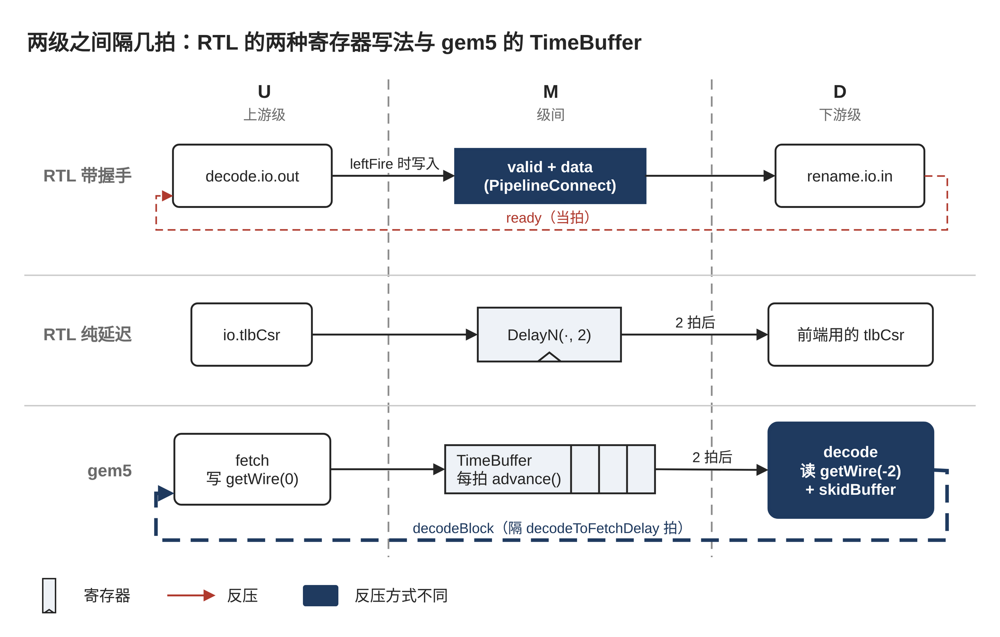

> 本文是 xiangshan-correlation 工作区的学习文档，随仓库保存；图在 `figs/`，来源见 [`figs/README.md`](figs/README.md)。文中的 `文件:行号` 都是相对本仓库的链接，点击可直接跳到对应代码行。


# 00-1 两级之间隔几拍：级间寄存器与 TimeBuffer

> 属于 [00 两种写法：gem5 的建模手法与 RTL 的实现写法](00-0-modeling-overview.md)，读法约定见总览 §0。标 ✅ 的是直接从代码或配置读出的事实，标 ❓ 的是待核实。

本篇回答一个问题：gem5 里 `delay = N`，在什么情况下等于 RTL 里两级之间隔着 N 个寄存器，什么情况下不等于。先看 RTL 的三种写法，再看 gem5 的 TimeBuffer，最后对照。



## 1. RTL：每隔一拍就是一个寄存器

RTL 里"隔一拍"一定落在某个寄存器上。香山常见三种写法。

**写法一：带握手的级间寄存器。** IFU 的 f0→f1 是最直接的例子（摘录，注释是加的；[`IFU.scala:291-298`](../../XiangShan/src/main/scala/xiangshan/frontend/IFU.scala#L291-L298)）✅：

```scala
val f1_valid   = RegInit(false.B)
val f1_ftq_req = RegEnable(f0_ftq_req, f0_fire)   // 上游 fire 时才写入
val f1_fire    = f1_valid && f2_ready
f1_ready := f1_fire || !f1_valid                  // 当拍告诉上游能不能再送
```

数据寄存器只在上游 `fire` 时写入；下游不收（`f2_ready` 为假）时，`f1_valid` 保持为真，数据原地不动，`f1_ready` 在**同一拍**变假，上游当拍就停。这一级寄存器既是"隔一拍"，也是"堵住时存东西的地方"。

后端把这套写法封装成 [`PipelineConnect`](../../XiangShan/utility/src/main/scala/utility/PipelineConnect.scala#L108-L117) ✅：一个 `valid` 寄存器，`leftFire` 时置位、下游取走时清零、`isFlush` 时清零；数据用 `RegEnable(left.bits, leftFire)` 存；`left.ready := right.ready && !block`，同样是当拍反压。decode→rename 就用它（[`CtrlBlock.scala:578`](../../XiangShan/src/main/scala/xiangshan/backend/CtrlBlock.scala#L578)），每个译码通道一份。

**写法二：不看握手的纯延迟。** [`DelayN`](../../XiangShan/utility/src/main/scala/utility/Hold.scala#L102) 是 N 个串起来的 `RegNext`，每拍无条件往后挪一格，没有 valid 也没有 ready ✅。例如前端拿到的 TLB 控制寄存器是 [`DelayN(io.tlbCsr, 2)`](../../XiangShan/src/main/scala/xiangshan/frontend/Frontend.scala#L120)：CSR 改了，前端两拍后才看到。IFU 里给 top-down 打标的 [`topdown_stages`](../../XiangShan/src/main/scala/xiangshan/frontend/IFU.scala#L161) 也是这种"只由时钟驱动"的链。

**写法三：SRAM 自带的一拍。** SRAM 的读数据在发地址的下一拍才出来，寄存器在 SRAM 宏单元里面，代码里看不到。FTB 在 s0 用 `s0_pc` 发读（[`FTB.scala:673`](../../XiangShan/src/main/scala/xiangshan/frontend/FTB.scala#L673)），读出的表项 s1 才有；为了在 s1 比 tag，s0 时要把 tag 另存进 [`req_tag`](../../XiangShan/src/main/scala/xiangshan/frontend/FTB.scala#L528) 寄存器，和 SRAM 的输出对齐（[`FTB.scala:536-538`](../../XiangShan/src/main/scala/xiangshan/frontend/FTB.scala#L536-L538)）✅。所以读 RTL 数拍数时，SRAM 也要算一级。

## 2. gem5：每隔一拍就是 TimeBuffer 里的一格

**数据结构** ✅。[`TimeBuffer`](../../GEM5-XS/src/cpu/timebuf.hh#L40) 是一个环形数组，长度为 `past + future + 1`（[`timebuf.hh:140-142`](../../GEM5-XS/src/cpu/timebuf.hh#L140-L142)），每一格放一整个结构体（例如一拍里取出的全部指令）。

- [`getWire(idx)`](../../GEM5-XS/src/cpu/timebuf.hh#L232) 返回一个绑定到"相对现在第 idx 格"的句柄。句柄记的是相对位置，不是固定的格子，所以 `getWire(-2)` 永远指向"两拍前写进去的那一格"。
- [`advance()`](../../GEM5-XS/src/cpu/timebuf.hh#L179-L188) 把基准位置往前挪一格，并清空新的"当前格"。所以每拍开始时 `getWire(0)` 都是空的。

**用法** ✅。CPU 构造时建好各级之间的 TimeBuffer，大小由 `backComSize`、`forwardComSize`（默认都是 10）决定（[`cpu.cc:116-120`](../../GEM5-XS/src/cpu/o3/cpu.cc#L116-L120)、[`BaseO3CPU.py:163-165`](../../GEM5-XS/src/cpu/o3/BaseO3CPU.py#L163-L165)）。每个 stage 在构造时拿好自己的句柄：

- fetch 写 [`toDecode = getWire(0)`](../../GEM5-XS/src/cpu/o3/fetch.cc#L413)；
- decode 读 [`fromFetch = getWire(-fetchToDecodeDelay)`](../../GEM5-XS/src/cpu/o3/decode.cc#L216)，再写 [`toRename = getWire(0)`](../../GEM5-XS/src/cpu/o3/decode.cc#L207)；
- 所有 stage 的 `tick()` 跑完后，[`CPU::tick`](../../GEM5-XS/src/cpu/o3/cpu.cc#L586) 统一 `advance()`。

于是第 t 拍写进 `getWire(0)` 的东西，第 t + delay 拍在 `getWire(-delay)` 读到，中间隔 delay 拍。

**同一个结构也用在一个 stage 内部** ✅。发射队列用 [`inflightIssues(scheduleToExecDelay, 0)`](../../GEM5-XS/src/cpu/o3/issue_queue.cc#L194-L198) 表示"选中之后还要过几拍才到执行单元"，也就是 RTL 的 og0、og1 两拍，每拍在 [`issue_queue.cc:664`](../../GEM5-XS/src/cpu/o3/issue_queue.cc#L664) 推进。

## 3. 对照：什么时候 delay = N 不等于 N 个寄存器

**等价的情况：没有反压、没有冲刷。** TimeBuffer 每拍无条件推进一格，和 RTL 的 `DelayN` 一模一样。所以比较一条路径"不堵时要几拍"时，RTL 数寄存器（连 SRAM 那一拍）、gem5 加 delay 参数，两边可以直接比。01-3 里取指的"RTL 4 拍、gem5 3 拍"就是这样数出来的。

**不等价一：反压。** 这是最大的差别。

- RTL 带握手的寄存器在下游不收时**原地保持**，`ready` 当拍组合地传回上游，上游同一拍就停。
- TimeBuffer 不能"保持"，每拍都会推进。gem5 的反压是另走一条 TimeBuffer 往回送的：decode 堵住时写 [`toFetch->decodeBlock`](../../GEM5-XS/src/cpu/o3/decode.cc#L283)，fetch 在 [`decodeToFetchDelay`](../../GEM5-XS/src/cpu/o3/fetch.cc#L397) 拍之后才读到（[`fetch.cc:1567`](../../GEM5-XS/src/cpu/o3/fetch.cc#L1567)），才停止送指令。
- 这期间已经在 TimeBuffer 里的指令照样会到 decode，所以 decode 需要一个 skid buffer 接住它们，容量是 [`(fetchToDecodeDelay + 1) × fetchWidth`](../../GEM5-XS/src/cpu/o3/decode.cc#L86) ✅。解除阻塞也一样要等 skid buffer 清空、再隔几拍才传到上游（[`decode.cc:297-299`](../../GEM5-XS/src/cpu/o3/decode.cc#L297-L299)）。

所以 RTL 里一个"带握手的寄存器"，在 gem5 里对应的是"TimeBuffer + 下游的 skid buffer + 往回走的阻塞信号"三件东西。堵住和恢复的时刻都比 RTL 晚几拍，频繁短暂堵塞时两边的空泡数可能不一样 ❓（没有量化）。

**不等价二：冲刷。** RTL 冲刷时把各级寄存器的 `valid` 当拍清零（例如 `PipelineConnect` 的 `isFlush`）。TimeBuffer 里已经写进去的东西不会自己消失，要么由下游检查指令是否已被 squash 后丢弃，要么像发射队列那样逐格把被 squash 的指令置空（[`issue_queue.cc:777-785`](../../GEM5-XS/src/cpu/o3/issue_queue.cc#L777-L785)）✅。细节放在 00-3 冲刷与推翻（待写，见 [00 总览](00-0-modeling-overview.md) §2）。

**不等价三：SRAM。** gem5 没有 SRAM，存储结构的延迟就是一个数字（cache 的 `tag_latency`、`data_latency`，预测器的 `numDelay`）。RTL 的 SRAM 那一拍是物理上躲不掉的，旁边还要配寄存器对齐。01-3 里 ICache 命中 RTL 2 拍、gem5 1 拍，差的正是这一拍。

### 精读结论（2026-10-24）：TimeBuffer 等价于不带握手的寄存器链，反压和冲刷要另外建模 ✅

1. `delay = N` 等价于 RTL 的 `DelayN(·, N)`，即 N 个无条件推进的寄存器。数"不堵时的拍数"可以直接比。
2. RTL 大多数级间寄存器带握手：堵住时原地保持，`ready` 当拍传回。gem5 用 skid buffer 加往回走的阻塞信号来近似，反压的生效和解除都要晚 `decodeToFetchDelay` 这类参数那么多拍。
3. 做 correlation 时，"不堵时几拍"对上了，不代表"堵住之后几拍恢复"也对上了。后者要单独看两边的反压路径。
