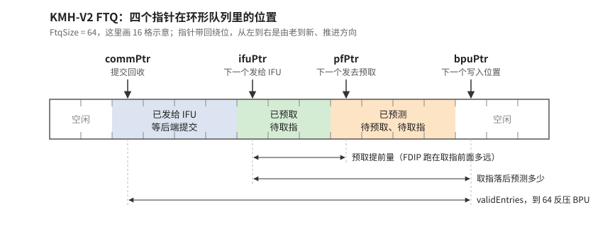
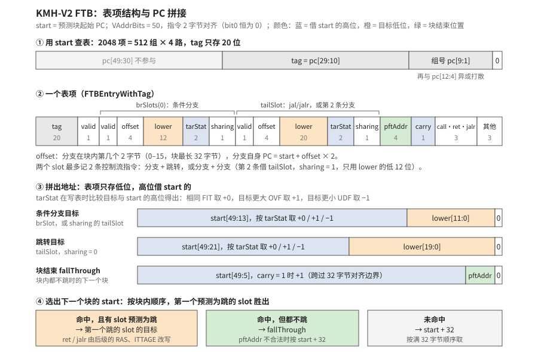

> 本文是 xiangshan-correlation 工作区的学习文档，随仓库保存；图在 `figs/`，来源见 [`figs/README.md`](figs/README.md)。文中的 `文件:行号` 都是相对本仓库的链接，点击可直接跳到对应代码行。

# 01-1 🆕 解耦前端：FTQ 与 FTB

> 属于 [01 香山流水线微架构总览：RTL 与 gem5 对照](01-0-pipeline-overview.md)，全流水对照图见总览，读法约定见 [00 两种写法](00-0-modeling-overview.md)。标 ✅ 的是直接从代码或配置读出的事实，标 ❓ 的是待核实，🆕 是课本（Computer Architecture A Quantitative Approach Ch3）没有的东西。

## 1. 解耦前端（decoupled frontend）与 FTQ

官方前端总览（南湖版文档，结构与昆明湖 V2 相同；ICache 容量等参数以 V2 为准）：

课本的取指是"PC → ICache → 译码"，分支预测只是给下一个 PC。香山把预测和取指拆成两条独立流水，中间放一个 **FTQ（Fetch Target Queue）**：BPU 以"预测块"为单位往 FTQ 里填（起始地址、块内最多 `numBr = 2` 条分支、跳转目标），IFU 按自己的节奏从 FTQ 取请求去访问 ICache。好处是预测器可以跑在取指前面，取指停了预测也不停；FTQ 里排着的预测块还能用来做取指方向的指令预取（香山前端 README 引的 Ishii 2020/2021 FDIP 两篇就是这个）。

官方的 FTQ 接口图，可以看到 FTQ 同时面对 BPU（pred / meta 进、训练出）、IFU（req 出、pdInfo / redirect 回）、后端（exu redirect / commit 进、pc 读出）和预取：

- RTL：[`frontend/NewFtq.scala`](../../XiangShan/src/main/scala/xiangshan/frontend/NewFtq.scala#L461)，[`FtqSize = 64`](../../XiangShan/src/main/scala/xiangshan/Parameters.scala#L157)，四个指针 `bpuPtr`（预测写入）、`ifuPtr`（取指读出）、`pfPtr`（预取）、`commPtr`（提交回收）✅。
- gem5：[`cpu/pred/ftb/fetch_target_queue.cc`](../../GEM5-XS/src/cpu/pred/ftb/fetch_target_queue.cc#L15)，[`DecoupledBPUWithFTB.ftq_size = 128`](../../GEM5-XS/src/cpu/pred/BranchPredictor.py#L943) 是 Python 默认值，[`kmhv2.py`](../../GEM5-XS/configs/example/kmhv2.py) 和 [`xiangshan.py`](../../GEM5-XS/configs/common/xiangshan.py#L361) 都没有覆盖（[`kmhv3.py`](../../GEM5-XS/configs/example/kmhv3.py#L95) 才改成 256）✅。但名字相同的两个队列并不对应 ✅（2026-10-24 两次独立核查）：gem5 有两个队列。**FSQ**（`fetchStreamQueue`，[`fsq_size = 64`](../../GEM5-XS/src/cpu/pred/BranchPredictor.py#L944)）存每个预测流，从预测一直到提交，满了就停止预测（[`streamQueueFull`](../../GEM5-XS/src/cpu/pred/ftb/decoupled_bpred.hh#L355)），提交时出队（[`decoupled_bpred.cc:1817`](../../GEM5-XS/src/cpu/pred/ftb/decoupled_bpred.cc#L1817)），它才是 RTL FTQ（`bpuPtr` 到 `commPtr`）的对应物。**FTQ** 由 [`tryEnqFetchTarget`](../../GEM5-XS/src/cpu/pred/ftb/decoupled_bpred.cc#L2233) 从 FSQ 每个流搬一项进来，fetch 取完就删，只相当于 RTL FTQ 里 `ifuPtr` 到 `bpuPtr` 那一段；它的占用不会超过 FSQ，所以 128 在 kmhv2 下永远碰不到（一个流拆成多项只发生在 jump-ahead 打开时，kmhv2 关着）。**结论：两边队列深度都是 64，"FTQ 深度差"这个嫌疑排除。**剩下的差异只在释放条件，影响边界几拍：RTL 释放一项还要求 IFU 已写回且 BPU 没有悬而未决的覆盖（[`NewFtq.scala:1358`](../../XiangShan/src/main/scala/xiangshan/frontend/NewFtq.scala#L1358)），一拍最多释放一项；gem5 的第 N 个流要等第 N+1 个流的指令开始提交才删除（[`commit.cc:1356`](../../GEM5-XS/src/cpu/o3/commit.cc#L1356)），一次可删多项。
- 思想归类：FTQ 是 Prediction 和 Parallelism 的接合处——把"猜"和"取"解耦成两条并行流水。

**FTQ 驱动的指令预取（FDIP）。** 四个指针在队列里的位置（从老到新）：

`ifuPtr` 到 `bpuPtr` 之间是 BPU 已经预测好、IFU 还没取的未来地址。`pfPtr` 在这段里往前走，只要 `pfPtr =/= bpuPtr` 就把地址先发给 ICache 预取（[`NewFtq.scala:917`](../../XiangShan/src/main/scala/xiangshan/frontend/NewFtq.scala#L917)，预取通道在 [`IPrefetch.scala`](../../XiangShan/src/main/scala/xiangshan/frontend/icache/IPrefetch.scala)）✅。直觉分三层：

1. **比 next-line 预取准**：它沿着预测的控制流跳转，函数调用、循环回跳都能跟上。代价是准确率取决于分支预测；预测错时 `pfPtr` 被拉回（[`NewFtq.scala:769`](../../XiangShan/src/main/scala/xiangshan/frontend/NewFtq.scala#L769)、[`NewFtq.scala:1278`](../../XiangShan/src/main/scala/xiangshan/frontend/NewFtq.scala#L1278)），已经发出的错误路径预取作废。
2. **IFU 停下时预取跑得最远**：IFU 因 ICache 缺失等待时 BPU 不停，FTQ 越积越满，`pfPtr` 继续往前发预取，连续几次缺失从串行变成重叠，相当于取指侧的访存级并行。
3. **所以 FTQ 深度决定预取提前量的上限**：两边的有效深度都是 64 个块（gem5 由 FSQ 限定，见上），这一项不构成差异。

gem5 侧没有 FDIP，L1I 也没有预取器 ✅（2026-10-24 核实，见 [01-3](01-3-ifu.md)）。代码体积大的 SPEC 负载（gcc、perlbench）上 gem5 的前端停顿会偏多，CoreMark 影响小。另外，图中 `pfPtr` 在 `ifuPtr` 之前是正常情况；代码只断言 `pfPtr` 不越过 `bpuPtr`（[`NewFtq.scala:795`](../../XiangShan/src/main/scala/xiangshan/frontend/NewFtq.scala#L795)），两者的先后没有硬约束 ❓。图里省略了 `ifuWbPtr`（IFU 预译码写回）和 `robCommPtr`，它们都在 `commPtr` 与 `ifuPtr` 之间。

## 2. FTB 而不是 BTB，预测块而不是单条分支

课本的 BTB 按单条分支的 PC 索引。香山的 **FTB（Fetch Target Block）** 按预测块的起始 PC 索引，一个表项记录这个块里最多 2 条分支的位置和目标，再加一个"块在哪结束"。于是一次查表给出的是"从这里取多少字节、在哪分叉"，天然配合 FTQ。

**为什么只能用 PC 索引**：BPU 要在取指之前就猜出"从这个地址开始的块里有没有跳转、跳到哪"。这时指令还没从 ICache 取回来，更谈不上译码，指令内容是看不到的，唯一知道的就是这个块的起始地址。所以 FTB 只能是一张以 PC 为键的缓存：同一段代码再次执行时起始 PC 相同，就能查回上次学到的块结构。课本 BTB 用 PC 索引也是这个原因，差别只在粒度（单条分支的 PC 对整块的起始 PC）。

表项结构和 PC 怎么拼出来：

- 表项定义在 [`FTBEntry`](../../XiangShan/src/main/scala/xiangshan/frontend/FTB.scala#L178)：一个只放条件分支的 `brSlots(0)`（目标低 12 位），一个 `tailSlot`（目标低 20 位），放 jal/jalr，或者以 `sharing = 1` 放第 2 条条件分支。槽位宽度见 [`BR_OFFSET_LEN`、`JMP_OFFSET_LEN`](../../XiangShan/src/main/scala/xiangshan/frontend/FTB.scala#L39) ✅。
- **压缩的关键是"只存低位，高位借块起始 PC"**：目标 = {start 高位按 `tarStat` 取 +0/+1/−1, `lower`, 0}，见 [`FtbSlot.getTarget`](../../XiangShan/src/main/scala/xiangshan/frontend/FTB.scala#L74)；`tarStat` 在写表时比较目标与 start 的高位得出（[`setLowerStatByTarget`](../../XiangShan/src/main/scala/xiangshan/frontend/FTB.scala#L60)）✅。所以分支目标只能落在 start 所在的 8KB 对齐区间（`lower` 管 [12:1]）或相邻的一个里，跳转目标只能落在 start 所在的 2MB 对齐区间（[20:1]）或相邻的一个里；更远的目标 FTB 存不下。
- 块结束地址也一样压缩：fallThrough = {start[49:5] + `carry`, `pftAddr`, 0}，见 [`getFallThroughAddr`](../../XiangShan/src/main/scala/xiangshan/frontend/BPU.scala#L110) ✅。`pftAddr` 不合法时（[`fallThroughErr`](../../XiangShan/src/main/scala/xiangshan/frontend/FrontendBundle.scala#L665)）按 start + 32 处理。
- 下一个块的起始 PC 由 [`selectByTaken`](../../XiangShan/src/main/scala/xiangshan/frontend/FrontendBundle.scala#L529) 从 [第一个预测为跳的 slot 的目标, fallThrough, start + 32] 里选 ✅。

**预测块怎么划分。** 起点是上一个块预测出的下一个 PC（跳转目标或 fallThrough），只要求 2 字节对齐；所以同一段代码可能被几个块覆盖，跳进某块中间的跳转会以目标为起点另建表项。块的终点由提交时的 [`FTBEntryGen`](../../XiangShan/src/main/scala/xiangshan/frontend/NewFtq.scala#L217) 决定，最长 32 字节（`PredictWidth = 16` 个 2 字节）✅：

- **FTB 未命中，新建表项**（[`NewFtq.scala:263-283`](../../XiangShan/src/main/scala/xiangshan/frontend/NewFtq.scala#L263-L283)）：预译码发现 jal/jalr，块就在它之后结束，记进 `tailSlot`；没有就取满 32 字节（`carry = 1`）。条件分支只有这次真跳了才记进 `brSlot`，从没跳过的分支不进 FTB，默认就是预测不跳。跨出窗口的最后一条 32 位跳转不作块尾，并置 `last_may_be_rvi_call`。
- **FTB 命中，又发现一条新的跳转分支**（[`NewFtq.scala:300-352`](../../XiangShan/src/main/scala/xiangshan/frontend/NewFtq.scala#L300-L352)）：有空 slot 就按位置有序插入，边界不变；两个 slot 已满时块被截断，排序后第 3 条控制流指令被挤出，`pftAddr` 改为指向它，它成为下一个块的起点，被挤掉的 jal/jalr 连同 `isCall`/`isRet`/`isJalr` 一起清掉。
- **每次实际取指的范围**：有 slot 预测为跳就取到第一个跳的 slot 为止；都不跳取到 fallThrough；FTB 未命中取 start 到 start + 32。

所以块的终点取三者中最早的：满 32 字节、第一条 jal/jalr 之后、第 3 条控制流指令处；每次取指再在第一个预测为跳的地方提前停下。例子（`start = 0x1000`）：

| 事件 | 表项记录 | 块范围 |
|---|---|---|
| 首次执行，FTB 未命中；0x1014 有 jal，0x1008 的 beq 没跳 | `tailSlot` = jal（beq 不记） | [0x1000, 0x1018) |
| 0x1008 的 beq 跳了 | `brSlot` = beq，`tailSlot` = jal | 不变 |
| 0x1004 的 bne 也跳了，slot 已满 | `brSlot` = bne，`tailSlot` = beq（`sharing = 1`），jal 被挤出 | 截断为 [0x1000, 0x1014)，0x1014 的 jal 成为下一块起点 |

- RTL：[`frontend/FTB.scala`](../../XiangShan/src/main/scala/xiangshan/frontend/FTB.scala#L465)，[`FtbSize = 2048`](../../XiangShan/src/main/scala/xiangshan/Parameters.scala#L99)，4 路，tag 20 位；[`FauFTB.scala`](../../XiangShan/src/main/scala/xiangshan/frontend/FauFTB.scala#L76) 是全相联的小 FTB（uFTB），放在 s1 级零延迟出结果 ✅。
- gem5：`pred/ftb/` 下的 [`decoupled_bpred.cc`](../../GEM5-XS/src/cpu/pred/ftb/decoupled_bpred.cc) 和 [`ftb.cc`](../../GEM5-XS/src/cpu/pred/ftb/ftb.cc)。[`pred/README.md`](../../GEM5-XS/src/cpu/pred/README.md) 提醒 gem5 里同时存在 BTB 版、FTB 版、Stream 版三种解耦前端，`kmhv2.py` 走的是 [`DecoupledBPUWithFTB`](../../GEM5-XS/src/cpu/pred/BranchPredictor.py#L937)（[`bp_type 为空时的默认分支`](../../GEM5-XS/configs/common/xiangshan.py#L361)）✅。
