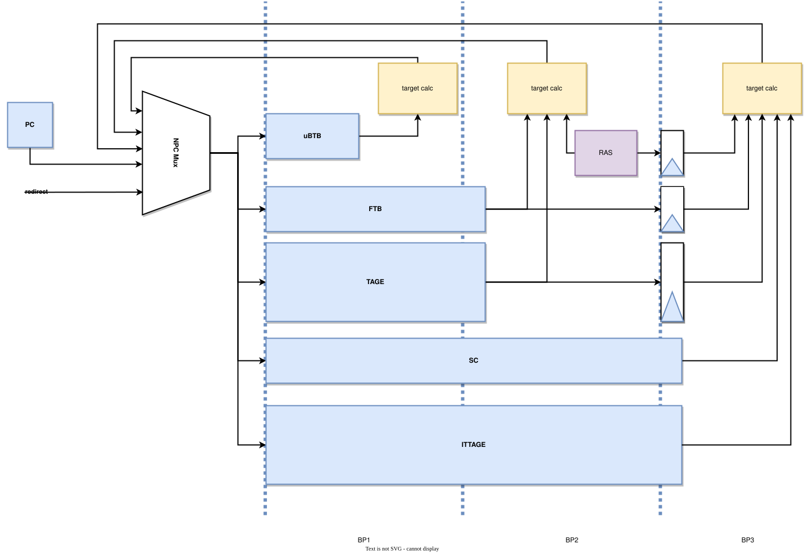
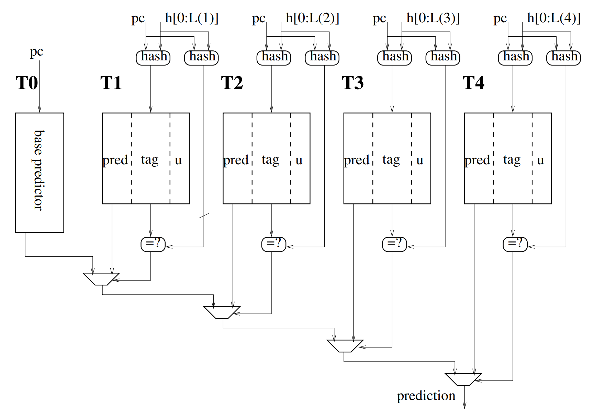
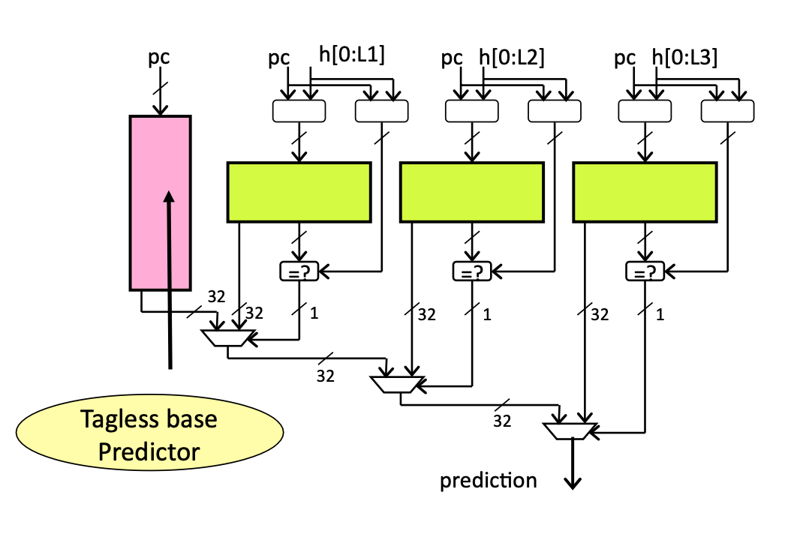
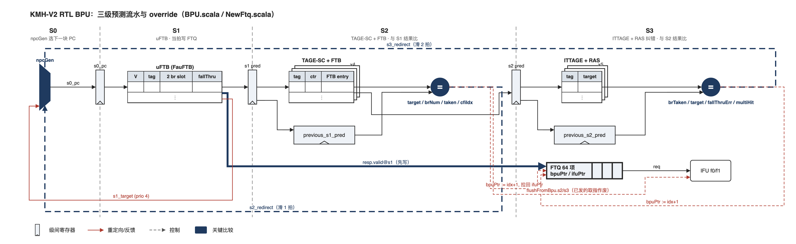
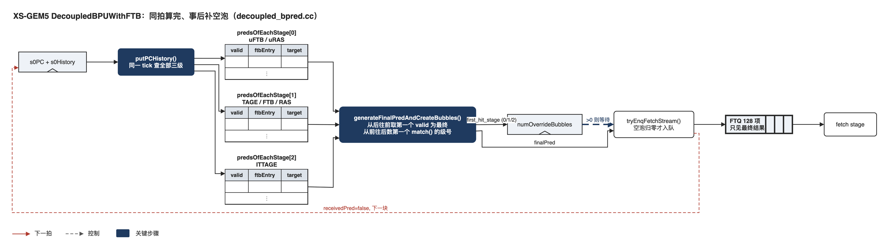

> 本文是 xiangshan-correlation 工作区的学习文档，随仓库保存；图在 `figs/`，来源见 [`figs/README.md`](figs/README.md)。文中的 `文件:行号` 都是相对本仓库的链接，点击可直接跳到对应代码行。

# 01-2 🆕 三级预测流水与 override

> 属于 [01 香山流水线微架构总览：RTL 与 gem5 对照](01-0-pipeline-overview.md)，全流水对照图见总览，读法约定见 [00 两种写法](00-0-modeling-overview.md)。标 ✅ 的是直接从代码或配置读出的事实，标 ❓ 的是待核实，🆕 是课本（Computer Architecture A Quantitative Approach Ch3）没有的东西。

官方的预测流水图（BP1 / BP2 / BP3 对应本文的 s1 / s2 / s3）。看三件事：uBTB 在 BP1 就出目标；FTB、TAGE、RAS 的结果在 BP2 出；SC、ITTAGE 最慢，BP3 才出；每一级的 target calc 都有一根线绕回最左边的 NPC Mux，这就是 override：

读图时注意：NPC Mux 的输出 `s0_pc` 在 s0 当拍就作为读地址送进 uFTB、FTB、TAGE 等预测器。对 FTB、TAGE 这类用 SRAM 实现的表，SRAM 本身就相当于 s0 和 s1 之间的那一级寄存器，读出的数据在 s1 才出现。所以图里 FTB 横跨 BP1、BP2，且在 BP1 不连 target calc：FTB 的一次查询分三步，在 RTL 里正好落在 s0 到 s2 三拍 ✅：

| 拍 | FTB 在做什么 | 代码 |
|---|---|---|
| s0 | 用 `s0_pc` 算出组号，向 SRAM 发读请求；同时把 tag 存进寄存器 `req_tag` | [`FTB.scala:673-674`](../../XiangShan/src/main/scala/xiangshan/frontend/FTB.scala#L673-L674)、[`FTB.scala:528`](../../XiangShan/src/main/scala/xiangshan/frontend/FTB.scala#L528) |
| s1（BP1） | SRAM 读出 4 路的表项和 tag，4 路同时和 `req_tag` 比较得到 `total_hits`，再按命中的路选出表项 | [`FTB.scala:536-540`](../../XiangShan/src/main/scala/xiangshan/frontend/FTB.scala#L536-L540) |
| s2（BP2） | 读出的表项先打一拍寄存器（`s2_ftbBank_dup`），再用 `fromFtbEntry` 拼出各个目标和 fallThrough，交给 target calc | [`FTB.scala:686`](../../XiangShan/src/main/scala/xiangshan/frontend/FTB.scala#L686)、[`FTB.scala:785-797`](../../XiangShan/src/main/scala/xiangshan/frontend/FTB.scala#L785-L797) |

TAGE 和 ITTAGE 的原理图（官方）：

课本的预测器是"一拍出结果"。香山把预测器按延迟排成三级，每一级都可以推翻前一级：

| 级 | RTL 里谁在这一级 | gem5 `numDelay` | 推翻前级时付出的空泡 |
| --- | --- | --- | --- |
| s1 | uFTB（FauFTB） | uFTB 0、uRAS 0 | 0 |
| s2 | TAGE-SC、FTB、RAS 的投机 push/pop | TAGE 1、FTB 1、RAS 1 | 1 |
| s3 | ITTAGE、RAS 的 s3 纠错（`s3_recover`） | ITTAGE 2 | 2 |

RTL 的组合顺序在 [`Parameters.scala:124`](../../XiangShan/src/main/scala/xiangshan/Parameters.scala#L124) 的 `branchPredictor` 里写死：`uftb → tage(SC) → ftb → ittage → ras`，后一个的 `resp_in` 接前一个的 `out` ✅。注意这是**组合顺序不是流水级**：[`newRAS.scala:620`](../../XiangShan/src/main/scala/xiangshan/frontend/newRAS.scala#L620) 里 `s2_spec_push/pop` 由 `s2_fire` 驱动，s3 只做纠错 ✅，所以 RAS 的主体在 s2，与 gem5 的 [`FTBRAS.numDelay = 1`](../../GEM5-XS/src/cpu/pred/BranchPredictor.py#L894) 一致；ITTAGE 的结果在 `s2_fire` 时打进 s3 寄存器（[`ITTAGE.scala:460`](../../XiangShan/src/main/scala/xiangshan/frontend/ITTAGE.scala#L460)）✅，对应 gem5 的 [`FTBITTAGE.numDelay = 2`](../../GEM5-XS/src/cpu/pred/BranchPredictor.py#L935)。[`BPU.scala:245`](../../XiangShan/src/main/scala/xiangshan/frontend/BPU.scala#L245) 里 `numOfStage = 3`，[`overrideBubble`](../../XiangShan/src/main/scala/xiangshan/frontend/BPU.scala#L264) 和 `ftqUpdateBubble` 两组线专门给 top-down 记"被后级推翻"和"等 FTQ 更新"的空泡 ✅。

## 精读结论（2026-10-20）：两边的 override 是两种完全不同的建模，只在常见情形下拍数相等 ✅

官方图没有画 override 的实现细节，下面两张是从代码画出来的。先看 RTL：

**RTL 是真流水线，先写后改。** [`BPU.scala`](../../XiangShan/src/main/scala/xiangshan/frontend/BPU.scala)：

- [`io.bpu_to_ftq.resp.valid`](../../XiangShan/src/main/scala/xiangshan/frontend/BPU.scala#L452) 在 **s1** 就为真（`s1_valid && s2_ready`），uFTB 的结果当拍写进 FTQ，`bpuPtr` 前进。
- s2 用 [`preds_needs_redirect_vec`](../../XiangShan/src/main/scala/xiangshan/frontend/BPU.scala#L606) 把自己的结果和上一拍 s1 写下的比（[`BPU.scala:698`](../../XiangShan/src/main/scala/xiangshan/frontend/BPU.scala#L698)）：目标地址、块内分支数（`lastBrPosOH`）、是否 taken、taken 的是第几条（`cfiIndex`），再加 `fallThruError`。任一不同就 [`s2_redirect`](../../XiangShan/src/main/scala/xiangshan/frontend/BPU.scala#L704)：`s1_flush`，[`npcGen`](../../XiangShan/src/main/scala/xiangshan/frontend/BPU.scala#L707) 以优先级 5 把 s0 的 PC 改成 s2 的目标，同时 FTQ 侧 [`bpuPtr := s2.ftq_idx + 1`](../../XiangShan/src/main/scala/xiangshan/frontend/NewFtq.scala#L760)，并且如果 IFU 已经取走了这一项，`ifuPtr`、`pfPtr` 一并拉回，IFU 的 f0/f1 收到 `flushFromBpu.s2` 被冲掉。
- s3 同理，和寄存下来的 [`previous_s2_pred`](../../XiangShan/src/main/scala/xiangshan/frontend/BPU.scala#L792) 比（[`BPU.scala:851`](../../XiangShan/src/main/scala/xiangshan/frontend/BPU.scala#L851)）：`real_br_taken_mask`（但两边都 taken 第一槽时放过）、目标、`fallThruError`、`ftbMultiHit`。`s3_redirect` 冲掉 s1 和 s2。
- 空泡数：s2 推翻让预测流滑 1 拍，s3 推翻滑 2 拍；[`overrideBubble(0) := s2_redirect`](../../XiangShan/src/main/scala/xiangshan/frontend/BPU.scala#L1088)、`overrideBubble(1) := s3_redirect` 把这记进 top-down 的 `OverrideBubble`。

再看 gem5，注意它没有级间寄存器，三份预测在同一个 tick 里产生：

**gem5 不是流水线，是"同拍算完、事后补空泡"。** [`decoupled_bpred.cc`](../../GEM5-XS/src/cpu/pred/ftb/decoupled_bpred.cc)：

- [`tick()`](../../GEM5-XS/src/cpu/pred/ftb/decoupled_bpred.cc#L625) 里一次把三级预测器全部 [`putPCHistory`](../../GEM5-XS/src/cpu/pred/ftb/decoupled_bpred.cc#L666)，下一拍 [`generateFinalPredAndCreateBubbles()`](../../GEM5-XS/src/cpu/pred/ftb/decoupled_bpred.cc#L798) 从最后一级往前找第一个 valid 的当最终结果，再从 s1 往后数第一个与最终结果 [`match()`](../../GEM5-XS/src/cpu/pred/ftb/stream_struct.hh#L533) 的级，它的序号就是要补的空泡数（`first_hit_stage`）。
- 补空泡的方式是 BPU 停 N 拍不发新请求（[`numOverrideBubbles`](../../GEM5-XS/src/cpu/pred/ftb/decoupled_bpred.cc#L649) 递减，[`tryEnqFetchStream()`](../../GEM5-XS/src/cpu/pred/ftb/decoupled_bpred.cc#L2163) 等它归零才入队），**FTQ 从来不会收到错的那一项**，IFU 也就不会取错的块。
- 两个输入在同一拍、一次比较、只用最终结果，这是典型的"functionally equivalent, timing approximated"的 Cmodel 写法。

**什么时候拍数相等，什么时候不等：**

| 三级结果 | RTL 空泡 | gem5 空泡 | 是否一致 |
| --- | --- | --- | --- |
| s1 = s2 = s3 | 0 | 0 | 一致 |
| s1 ≠ s2 = s3 | 1（s2 推翻） | 1 | 一致 |
| s1 = s2 ≠ s3 | 2（s3 推翻） | 2 | 一致 |
| s1 ≠ s2 ≠ s3 | 1 + 2 = 3（先 s2 推翻，下一拍 s3 再推翻） | 2 | **RTL 多 1** |
| 两边都不 taken，但块结束地址或分支数不同 | 1（RTL 比 `lastBrPosOH` 和 fall-through 目标） | 0（gem5 `match()` 在双方都无 taken 槽时直接判匹配） | **gem5 少 1** |

第二种不一致值得优先查：它的方向是让 gem5 前端更快，和 78 号点"RTL 前端 slot 多 108 万、gem5 IPC 高 1.35%"的方向一致。CoreMark 这种小循环体负载，uFTB 和 FTB 对"块在哪结束"的分歧（例如 uFTB 没命中、给了一个默认的 fall-through 长度）可能频繁发生。验证方法：RTL 侧看 `s2_redirect_because_branch_num_diff` 和 `s2_redirect_when_not_taken` 这两个 perf 计数器，gem5 侧看 `overrideCount` 和按原因分的 `overrideFallThruMismatch`、`overrideEndMismatch`；如果 RTL 的不 taken 推翻数远大于 gem5 的 end/fallThru 推翻数，就坐实了。

**第三个差别不在空泡数，在谁被冲掉。** RTL 的 s1 结果已经进了 FTQ，IFU 跟得紧时可能已经按它发了 ICache 请求，推翻时 IFU 的 f0/f1 一起作废；gem5 的 FTQ 只见最终结果，IFU 永远不会白取。IPC 接近 3 的 CoreMark 上 FTQ 大概率是浅的，IFU 紧跟 BPU，这部分损失 RTL 会记到 `OverrideBubble` 之外的取指空泡里。这一条和第三步的 top-down 口径对照直接相关。

**对课本的补充：** 课本讲 override 预测器（H&P 讲 tournament、TAGE 时只给一拍模型），没有讲"先把快的结果交出去再撤回"的流水线实现。RTL 这套 `previous_s1/s2_pred` 寄存加四项比较、`npcGen` 优先级仲裁、FTQ 指针回拉，是设计里真正的时序考量；gem5 把它折叠成一个整数 `numOverrideBubbles`，丢掉的正是"撤回"这半边。

## 预测器表项对照（✅ 从两边配置读出）

| 预测器 | RTL | gem5 |
| --- | --- | --- |
| TAGE | 4 表，sets 4096，hist 8/13/32/119，tag 8（[`Parameters.scala:106`](../../XiangShan/src/main/scala/xiangshan/Parameters.scala#L106)） | 4 表，tableSizes 2048×4，hist 8/13/32/119（[`BranchPredictor.py:913`](../../GEM5-XS/src/cpu/pred/BranchPredictor.py#L913)） |
| ITTAGE | 5 表，sets 256/256/512/512/512，hist 4/8/13/16/32，tag 9（[`Parameters.scala:112`](../../XiangShan/src/main/scala/xiangshan/Parameters.scala#L112)） | 5 表，256×2 + 512×3，hist 4/8/13/16/32（[`BranchPredictor.py:928`](../../GEM5-XS/src/cpu/pred/BranchPredictor.py#L928)） |
| SC | 4 表，512 行，hist 0/4/10/16，6 位计数器 | `tage.enableSC` 默认开 |
| RAS | RasSize 16，RasSpecSize 32（[`Parameters.scala:102`](../../XiangShan/src/main/scala/xiangshan/Parameters.scala#L102)） | FTBRAS 32 项（[`BranchPredictor.py:886`](../../GEM5-XS/src/cpu/pred/BranchPredictor.py#L886)），uRAS 4 项（[`BranchPredictor.py:896`](../../GEM5-XS/src/cpu/pred/BranchPredictor.py#L896)） |

❓ TAGE 的 4096 对 2048：RTL 的 `TageBanks = numBr = 2`，可能是每个 bank 2048 行、共 4096；需要看 [`Tage.scala:162`](../../XiangShan/src/main/scala/xiangshan/frontend/Tage.scala#L162) 的 bank 索引函数确认是"2 bank × 2048"还是真的差一倍。这类"同名不同义"正是第三步要练的眼力。
