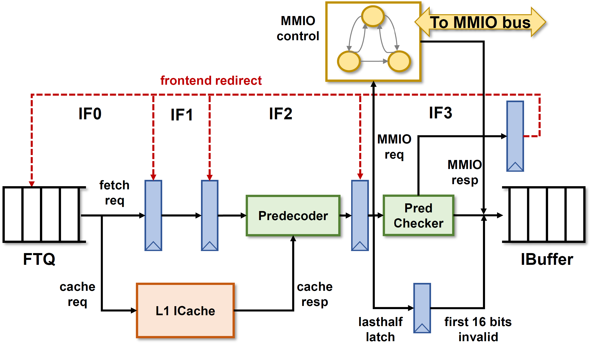

> 本文是 xiangshan-correlation 工作区的学习文档，随仓库保存；图在 `figs/`，来源见 [`figs/README.md`](figs/README.md)。文中的 `文件:行号` 都是相对本仓库的链接，点击可直接跳到对应代码行。

# 01-3 IFU 的四拍与 gem5 的两拍

> 属于 [01 香山流水线微架构总览：RTL 与 gem5 对照](01-pipeline-overview.md)，读法约定和全流水对照图见总览。标 ✅ 的是直接从代码或配置读出的事实，标 ❓ 的是待核实，🆕 是课本（Computer Architecture A Quantitative Approach Ch3）没有的东西。

官方的 IFU 流水图（IFU0 / IF1 / IF2 / IF3 对应本文 f0 / f1 / f2 / f3）：

RTL [`IFU.scala`](../../XiangShan/src/main/scala/xiangshan/frontend/IFU.scala#L130) ✅：

- f0：从 FTQ 收请求（[`fromFtq.req.fire`](../../XiangShan/src/main/scala/xiangshan/frontend/IFU.scala#L245)），同时向 ICache 发两条 cache line 的请求（`doubleLine` 处理跨行）。[`fromFtq.req.ready := f1_ready && icacheReady`](../../XiangShan/src/main/scala/xiangshan/frontend/IFU.scala#L263)。
- f1：算出块内每条指令的 PC（[`f1_pc`](../../XiangShan/src/main/scala/xiangshan/frontend/IFU.scala#L291)、`f1_half_snpc`），处理 RVC 的 2 字节对齐。
- f2：[`f2_fire = f2_valid && f3_ready && icacheRespAllValid`](../../XiangShan/src/main/scala/xiangshan/frontend/IFU.scala#L362)，等 ICache 两行都回来，合并 ITLB/PMP/PBMT 的异常和 MMIO 标志。
- f3：预译码（`PreDecode`）、RVC 展开、分支信息检查（`checkerOutStage1/2`）、MMIO 状态机（[`mmio_state`](../../XiangShan/src/main/scala/xiangshan/frontend/IFU.scala#L661)）；[`f3_fire = io.toIbuffer.fire`](../../XiangShan/src/main/scala/xiangshan/frontend/IFU.scala#L560)。f3 还会向 FTQ 写回预译码发现的预测错误（[`wb_redirect`](../../XiangShan/src/main/scala/xiangshan/frontend/IFU.scala#L252)），这是前端自己的小重定向，与后端的 `backend_redirect` 分开。

gem5 把这四拍压成 [`fetchToDecodeDelay = 2`](../../GEM5-XS/src/cpu/o3/BaseO3CPU.py#L131)，再加 ICache 访问本身的延迟 ✅。❓ 两边"ICache 命中到指令进 IBuffer/fetchQueue"的总拍数是否一致，是前端 slot 差的第二个候选。

Top-down 在 IFU 里的打标方式 ✅：[`topdown_stages`](../../XiangShan/src/main/scala/xiangshan/frontend/IFU.scala#L161) 是一个 3 深的寄存器链，"只由时钟驱动，不看 valid-ready"，`icacheMissBubble`、[`itlbMissBubble`](../../XiangShan/src/main/scala/xiangshan/frontend/IFU.scala#L159) 两根线在 stage 1 打上 reason（枚举定义在 [`package.scala:963`](../../XiangShan/src/main/scala/xiangshan/package.scala#L963)），然后随链传到 `toIbuffer`。也就是说这个 reason 跟着**拍**走，不跟着**指令**走。第二步要回答的 `ITLBMissBubble` 92 万 slot 却 0 次 PTW，大概率就出在这个"按拍打标"的口径上。
