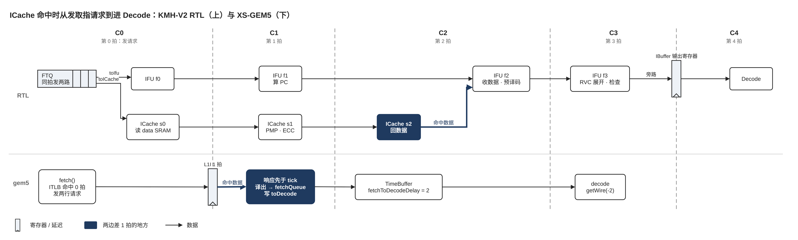

> 本文是 xiangshan-correlation 工作区的学习文档，随仓库保存；图在 `figs/`，来源见 [`figs/README.md`](figs/README.md)。文中的 `文件:行号` 都是相对本仓库的链接，点击可直接跳到对应代码行。

# 01-3 取指：从 FTQ 发请求到进 Decode

> 属于 [01 香山流水线微架构总览：RTL 与 gem5 对照](01-0-pipeline-overview.md)，全流水对照图见总览，读法约定见 [00 两种写法](00-0-modeling-overview.md)。标 ✅ 的是直接从代码或配置读出的事实，标 ❓ 的是待核实，🆕 是课本（Computer Architecture A Quantitative Approach Ch3）没有的东西。

本篇回答一个问题：ICache 命中时，一个预测块从 FTQ 发出取指请求，到指令进入 Decode，两边各要几拍。先看 RTL，再看 gem5，最后对照。

## 1. RTL：IFU 四级、ICache 三级、IBuffer 一个输出寄存器

官方的 IFU 流水图（IFU0 / IF1 / IF2 / IF3 对应本文 f0 / f1 / f2 / f3）：

**请求同拍发两路。** FTQ 在同一拍向 IFU 和 ICache 各发一份请求（[`NewFtq.scala:901`](../../XiangShan/src/main/scala/xiangshan/frontend/NewFtq.scala#L901)、[`NewFtq.scala:906`](../../XiangShan/src/main/scala/xiangshan/frontend/NewFtq.scala#L906)），两份请求的 ready 都是"IFU 能收且 ICache 能收"（[`Frontend.scala:201`](../../XiangShan/src/main/scala/xiangshan/frontend/Frontend.scala#L201)、[`Frontend.scala:211`](../../XiangShan/src/main/scala/xiangshan/frontend/Frontend.scala#L211)）✅。IFU 的 f0 不转发请求给 ICache，两条流水各走各的，IFU 在 f2 比对回来的地址。BPU 在第 T 拍刚写进 FTQ 的项，经旁路寄存器 [`bpu_in_bypass_buf`](../../XiangShan/src/main/scala/xiangshan/frontend/NewFtq.scala#L804) 在 T+1 拍就能发出（[`NewFtq.scala:875-877`](../../XiangShan/src/main/scala/xiangshan/frontend/NewFtq.scala#L875-L877)）✅。

**IFU 四级** ✅（[`IFU.scala`](../../XiangShan/src/main/scala/xiangshan/frontend/IFU.scala#L130)）：

| 级 | 做什么 | 推进条件 |
| --- | --- | --- |
| f0 | 收 FTQ 请求；BPU 的 s2/s3 推翻也在这一级冲掉请求 | [`f0_fire = fromFtq.req.fire`](../../XiangShan/src/main/scala/xiangshan/frontend/IFU.scala#L245)，[`ready = f1_ready && icacheReady`](../../XiangShan/src/main/scala/xiangshan/frontend/IFU.scala#L263) |
| f1 | 算出块内每条指令的 PC（[`f1_pc`](../../XiangShan/src/main/scala/xiangshan/frontend/IFU.scala#L291)、`f1_half_snpc`），处理 RVC 的 2 字节对齐 | [`f1_fire = f1_valid && f2_ready`](../../XiangShan/src/main/scala/xiangshan/frontend/IFU.scala#L296) |
| f2 | 收 ICache 数据，合并 ITLB/PMP/PBMT 异常和 MMIO 标志，按块边界切指令，预译码（组合） | [`f2_fire = f2_valid && f3_ready && icacheRespAllValid`](../../XiangShan/src/main/scala/xiangshan/frontend/IFU.scala#L362) |
| f3 | RVC 展开、预测检查第一段（屏蔽不该进 IBuffer 的指令）、MMIO 状态机（[`mmio_state`](../../XiangShan/src/main/scala/xiangshan/frontend/IFU.scala#L661)），写进 IBuffer | [`f3_fire = io.toIbuffer.fire`](../../XiangShan/src/main/scala/xiangshan/frontend/IFU.scala#L560) |
| wb | f3 的下一拍：预测检查第二段出结果，写回 FTQ | [`wb_valid = RegNext(wb_enable)`](../../XiangShan/src/main/scala/xiangshan/frontend/IFU.scala#L1098) |

**ICache 主流水三级** ✅（[`ICacheMainPipe.scala`](../../XiangShan/src/main/scala/xiangshan/frontend/icache/ICacheMainPipe.scala#L169)）：

- s0（与 IFU f0 同拍）：从 WayLookup 取出路掩码、物理 tag 和 ITLB 结果，命中与否此时已经知道（[`s0_hits`](../../XiangShan/src/main/scala/xiangshan/frontend/icache/ICacheMainPipe.scala#L198)）；向 data SRAM 发读（[`ICacheMainPipe.scala:217-227`](../../XiangShan/src/main/scala/xiangshan/frontend/icache/ICacheMainPipe.scala#L217-L227)）。
- s1：data SRAM 出数据，做 meta ECC 和 PMP 请求。
- s2：PMP 结果、data ECC，命中就把数据交给 IFU（[`toIFU.valid := s2_fire`](../../XiangShan/src/main/scala/xiangshan/frontend/icache/ICacheMainPipe.scala#L559)），IFU 此时在 f2。

🆕 主流水不读 meta，也不查 ITLB。这两件事由预取流水 IPrefetchPipe 提前做（[`IPrefetch.scala:262`](../../XiangShan/src/main/scala/xiangshan/frontend/icache/IPrefetch.scala#L262)、[`ICache.scala:720-721`](../../XiangShan/src/main/scala/xiangshan/frontend/icache/ICache.scala#L720-L721)），结果写进 WayLookup 给主流水用。预取由 FTQ 的 `pfPtr` 驱动，跑在取指前面，所以 ITLB 命中不占主流水的拍数 ✅。重定向之后 `pfPtr` 和 `ifuPtr` 同时被拉回，预取还没跑到前面时，主流水 s0 要等 WayLookup，可能多 1 拍 ❓。

**IBuffer 的输出是一级寄存器** ✅。[`IBuffer.scala`](../../XiangShan/src/main/scala/xiangshan/frontend/IBuffer.scala#L193) 的 `io.out` 只由寄存器 `outputEntries` 驱动（[`IBuffer.scala:279-283`](../../XiangShan/src/main/scala/xiangshan/frontend/IBuffer.scala#L279-L283)）。队列为空且 Decode 能收时走旁路（[`useBypass`](../../XiangShan/src/main/scala/xiangshan/frontend/IBuffer.scala#L215)），f3 送来的指令直接写进 `outputEntries`，下一拍就到 Decode；否则先写进队列，至少 2 拍。IBuffer 到 Decode 之间没有寄存器：[`io.backend.cfVec <> ibuffer.io.out`](../../XiangShan/src/main/scala/xiangshan/frontend/Frontend.scala#L439) 一路连到 [`decode.io.in`](../../XiangShan/src/main/scala/xiangshan/backend/CtrlBlock.scala#L500)。

**命中时的时间线**（第 0 拍是 FTQ 发出请求的那一拍）✅：

| 拍 | IFU | ICache | 其他 |
| --- | --- | --- | --- |
| 0 | f0 | s0：读 data SRAM | FTQ 同拍发两路 |
| 1 | f1：算 PC | s1 | |
| 2 | f2：收数据、预译码 | s2：回数据 | |
| 3 | f3：RVC 展开，写 IBuffer | | 旁路写进 `outputEntries` |
| 4 | wb：预测检查第二段 | | **Decode 收到指令**（IBuffer 不空时第 5 拍或更晚） |

**缺失时停在哪** ✅：

- ICache 缺失：主流水 s2 停住等 MSHR 回填（[`ICacheMainPipe.scala:576-578`](../../XiangShan/src/main/scala/xiangshan/frontend/icache/ICacheMainPipe.scala#L576-L578)），IFU f2 等 `icacheRespAllValid`，f1、f0 跟着堵住。
- ITLB 缺失：预取流水在 s1 反复重发 ITLB 请求，WayLookup 一直是空的，主流水 s0 走不了，FTQ 的请求发不出去。Top-down 用 [`topdownItlbMiss = s0_valid && !fromWayLookup.ready`](../../XiangShan/src/main/scala/xiangshan/frontend/icache/ICacheMainPipe.scala#L619) 记这种情况。注意它的条件是"WayLookup 没准备好"，预取没跑在前面时也成立，不一定真有 ITLB 缺失；这可能就是 `ITLBMissBubble` 有 92 万 slot 却 0 次 PTW 的原因 ❓（第三步核实）。

**预译码纠错** ✅：f3 的预测检查第一段只屏蔽 IBuffer 的写入；第二段在 wb 拍出结果（[`wb_redirect`](../../XiangShan/src/main/scala/xiangshan/frontend/IFU.scala#L1176)），同拍写回 FTQ（[`NewFtq.scala:1118`](../../XiangShan/src/main/scala/xiangshan/frontend/NewFtq.scala#L1118)）；FTQ 再打一拍（[`ifuRedirectReg`](../../XiangShan/src/main/scala/xiangshan/frontend/NewFtq.scala#L1134)）送给 BPU（[`NewFtq.scala:1331`](../../XiangShan/src/main/scala/xiangshan/frontend/NewFtq.scala#L1331)），BPU 再打一拍（[`BPU.scala:379`](../../XiangShan/src/main/scala/xiangshan/frontend/BPU.scala#L379)）才用新 PC 重新预测。照这条链往后数，从 wb 检出到正确路径的指令进 Decode 约 8 拍 ❓（BPU 之后的几拍是推算，没有逐行核对）。

**Top-down 在 IFU 里的打标方式** ✅：[`topdown_stages`](../../XiangShan/src/main/scala/xiangshan/frontend/IFU.scala#L161) 是一个 3 深的寄存器链，"只由时钟驱动，不看 valid-ready"，`icacheMissBubble`、[`itlbMissBubble`](../../XiangShan/src/main/scala/xiangshan/frontend/IFU.scala#L159) 两根线在 stage 1 打上 reason（枚举定义在 [`package.scala:963`](../../XiangShan/src/main/scala/xiangshan/package.scala#L963)），然后随链传到 `toIbuffer`。这个 reason 跟着**拍**走，不跟着**指令**走。

## 2. gem5：一个 tick 里发请求，下一个 tick 收数据并送出

**一个 tick 里先取指、后预测。** [`Fetch::tick`](../../GEM5-XS/src/cpu/o3/fetch.cc#L1312) 先做取指和送 decode，再跑 BPU 的 tick 并把新的 FTQ 项交给取指（[`fetch.cc:1531-1547`](../../GEM5-XS/src/cpu/o3/fetch.cc#L1531-L1547)）✅。所以 BPU 在第 B 个 tick 放进 FTQ 的项，取指在 B+1 才用，和 RTL 的"T 拍写、T+1 拍发"一样。

**发请求** ✅：`fetch()` 用完当前 FTQ 项后，在同一个 tick 末尾调 `sendNextCacheRequest` → [`fetchCacheLine`](../../GEM5-XS/src/cpu/o3/fetch.cc#L919)。取指缓冲 66 字节，**每次都取两行**（[`fetch.cc:941`](../../GEM5-XS/src/cpu/o3/fetch.cc#L941)、[`fetch.cc:636`](../../GEM5-XS/src/cpu/o3/fetch.cc#L636)），RTL 只在块跨行时才取两行。ITLB 是时序模型（[`xiangshan.py:326`](../../GEM5-XS/configs/common/xiangshan.py#L326) 的 `functional_tlb` 默认关），命中时当场完成翻译、当场发出 cache 请求（[`tlb.cc:2283`](../../GEM5-XS/src/arch/riscv/tlb.cc#L2283)），不占拍数。

**L1I 命中 1 拍** ✅：[`L1_ICache`](../../GEM5-XS/configs/common/Caches.py#L59) 的 tag、data 延迟都是 1，并行访问，`response_latency = 0`；命中延迟取两者最大值（[`base.cc:1688`](../../GEM5-XS/src/mem/cache/base.cc#L1688)），也就是 1 拍。响应事件的优先级高于 CPU 的 tick（[`base.cc:89`](../../GEM5-XS/src/mem/cache/base.cc#L89)），所以下一拍取指运行时数据已经到了。

**同一个 tick 里译出并送出** ✅：数据到达的那个 tick，取指把指令译出放进 fetchQueue（[`fetch.cc:1949`](../../GEM5-XS/src/cpu/o3/fetch.cc#L1949)），再从队头取最多 6 条写进 `toDecode`，也就是 TimeBuffer 的 `getWire(0)`（[`fetch.cc:1420-1431`](../../GEM5-XS/src/cpu/o3/fetch.cc#L1420-L1431)、[`fetch.cc:413`](../../GEM5-XS/src/cpu/o3/fetch.cc#L413)）；decode 读 [`getWire(-2)`](../../GEM5-XS/src/cpu/o3/decode.cc#L216)，2 拍后看到。

**命中时的时间线**（第 0 拍是发出 cache 请求的那一拍）✅：

| 拍 | 发生什么 |
| --- | --- |
| 0 | `fetch()` 末尾发两行请求，ITLB 命中不占拍 |
| 1 | 响应先到；取指译出指令进 fetchQueue，最多 6 条写进 `toDecode` |
| 2 | 在 TimeBuffer 里 |
| 3 | **decode 收到指令** |

**缺失时停在哪** ✅：等 cache 时取指状态为 `WaitingCache`，停顿原因记 `IcacheStall` 或 `ITlbStall`（[`fetch.cc:1018`](../../GEM5-XS/src/cpu/o3/fetch.cc#L1018)），要等两行都回来。L1 ITLB 缺失、L2TLB 命中加 1 拍（[`tlb.cc:1939-1942`](../../GEM5-XS/src/arch/riscv/tlb.cc#L1939-L1942)），全缺失走时序页表遍历。

**没有 FDIP** ✅：`cpu/pred/ftb/`、`fetch.cc` 和 `mem/cache/prefetch/` 里都没有 FTQ 驱动的预取；[`fetch.md:7`](../../GEM5-XS/src/cpu/o3/fetch.md#L7) 只说"为后续 FDIP 奠定基础"。L1I 也没有硬件预取器：[`--l1i-hwp-type`](../../GEM5-XS/configs/common/Options.py#L174) 默认 None，kmhv2 没设，[`create_prefetcher`](../../GEM5-XS/configs/common/PrefetcherConfig.py#L14) 返回 NULL。

**译码级纠错**：gem5 取指不做预译码检查，只照 FTQ 项走。直接跳转的目标和预测不符、预测跳转的不是控制流指令、没识别出的 return，都在 decode 发现（[`decode.cc:827-874`](../../GEM5-XS/src/cpu/o3/decode.cc#L827-L874)）✅，下一拍取指读到（[`decodeToFetchDelay = 1`](../../GEM5-XS/src/cpu/o3/fetch.cc#L397)）并重定向 BPU。照代码顺序推算，从 decode 检出到正确路径进 decode 约 7 拍，另加 0 到 2 个 override 空泡 ❓。

## 3. 对照

| 段 | RTL | gem5 |
| --- | --- | --- |
| BPU 写入 FTQ → 发出取指请求 | 1 拍（旁路寄存器） | 1 拍（下一个 tick 才用） |
| 发出请求 → 拿到 ICache 数据 | **2 拍**（s0 读 SRAM，s2 出数据） | **1 拍**（tag、data 并行） |
| 拿到数据 → 进 Decode | 2 拍（f3 一拍，IBuffer 输出寄存器一拍，需走旁路） | 2 拍（`fetchToDecodeDelay = 2`） |
| **发出请求 → 进 Decode，合计** | **4 拍**（IBuffer 不空时 ≥ 5） | **3 拍** |
| ITLB 命中 | 不占拍（预取流水提前查） | 不占拍 |
| 一次取几行 | 跨行时 2 行 | 总是 2 行 |
| FTQ 驱动的预取 | 有 | 无 |
| 预测错误最早在哪发现 | IFU 预译码（f3 下一拍） | decode |

### 精读结论（2026-10-24）：ICache 命中时 gem5 取指比 RTL 少 1 拍，差在 ICache 命中延迟 ✅

1. **差的 1 拍全在 ICache。** RTL 主流水 s0 发 SRAM 读、s2 才交数据，是 2 拍；gem5 的 L1I tag、data 并行，是 1 拍。拿到数据之后到 Decode，两边都是 2 拍：RTL 是 f3 加 IBuffer 输出寄存器，gem5 是 `fetchToDecodeDelay = 2`。
2. **这 1 拍只在重新取指时显现。** 两边取指都是流水的，稳定时每拍都能接下一个块，延迟差不影响吞吐（gem5 这一点是按代码推断的 ❓）。只有重定向之后、取指流水从空开始填时，RTL 多等 1 拍。按 78 号点的分支误预测重定向 11,476 次、每拍 6 个 slot 估算，这 1 拍最多带来约 7 万 slot，只占 RTL 前端多出的 108 万的 6% 左右，**不是主因**。预译码纠错和 BPU override 之后的重新取指也会多付这 1 拍，要加上它们的次数才是完整的估计。
3. **两处方向相反的差别。** gem5 没有 FDIP，ICache 缺失多的负载上 gem5 前端会更慢；CoreMark 代码小，影响应该不大。RTL 重定向后预取还没跑到前面时，主流水可能再多等 1 拍 ❓。
4. **下一步。** 前端 slot 差的主要来源还要往别处找：BPU override 的边角情形（[01-2](01-2-bpu-override.md)）和 top-down 按拍打标的口径（第三步）。
