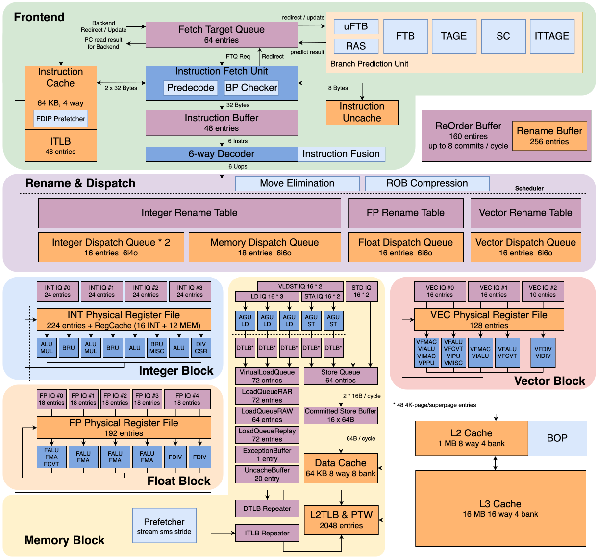
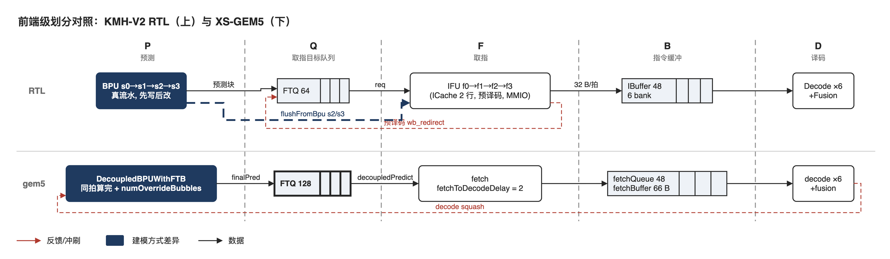
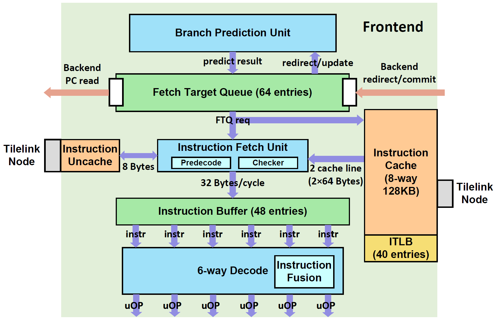
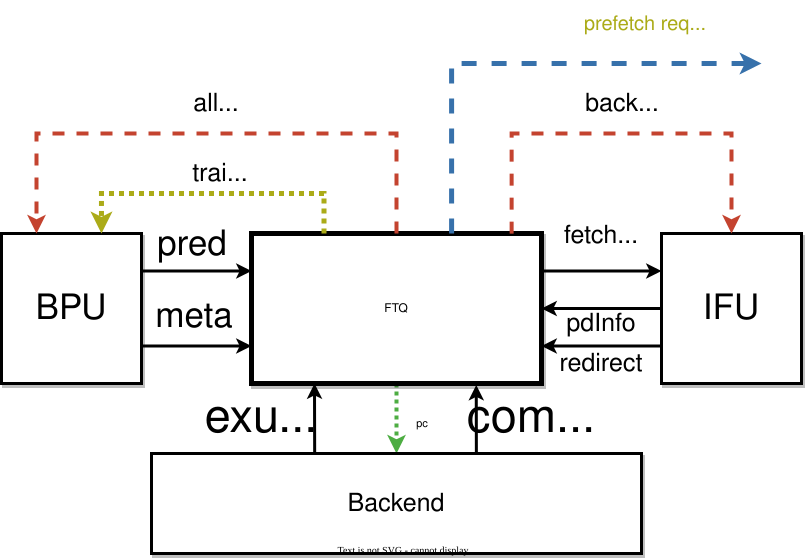

> 本文是 xiangshan-correlation 工作区的学习文档，随仓库保存；图在 `figs/`，来源见 `figs/README.md`。


# 01 香山流水线微架构总览：RTL 与 gem5 对照

> 学习计划第一步的起点，见 [xiangshan-correlation 学习计划 - 六大思想视角](README.md)。本篇是 2026-10-20 只读勘察 fdu-152 仓库得到的"地图"，不是精读结论：标 ✅ 的是直接从代码或配置读出的事实，标 ❓ 的是待核实。目的是让后面每次精读都有坐标。
>
> 读法约定：RTL 说"硬件用什么兑现，哪根信号在哪一拍"，gem5 说"该发生什么、隔几拍"。两边都读的时候，先问**这一级在 RTL 是一个寄存器边界还是一个模块边界**，再问 gem5 用哪个 delay 参数或哪个 TimeBuffer 位置来代替它。课本（Computer Architecture A Quantitative Approach Ch3）没有的东西用 🆕 标出。

---

## 0. 一张图：从预测到提交

先看官方的昆明湖整体架构图，本文的每一节都能在图里找到位置（前端在左上，Rename & Dispatch 在中间，整数 / 浮点 / 向量 / 访存四个 block 在下方）：



下面这张是本文的主线：同一条前端流水，上排 RTL、下排 gem5，每一级标出模块名和 gem5 对应的 delay 参数。深色块是两边建模方式不同的地方。



```
RTL (KMH-V2)                                       gem5 (XS-GEM5 KMH-V2, DecoupledBPUWithFTB)
──────────────────────────────────────────         ─────────────────────────────────────────
BPU  s0 → s1 → s2 → s3   (3 级预测流水, numOfStage=3) numStages = 3, 每个预测器带 numDelay
        │ uFTB  │ TAGE-SC+FTB │ ITTAGE+RAS               uRAS/uFTB 0, TAGE/FTB/RAS 1, ITTAGE 2
        ▼                                                ▼
FTQ  (FtqSize = 64, bpuPtr/ifuPtr/pfPtr/commPtr)   fetch_target_queue (ftq_size = 128 ❓)
        ▼                                                ▼
IFU  f0 → f1 → f2 → f3   (f3_fire = toIbuffer.fire)  fetch stage  ─ fetchToDecodeDelay = 2
        │ 发 ICache │ 算 PC │ 等 ICache 回数据+异常合并 │ 预译码+RVC 展开+MMIO 状态机
        ▼                                                ▼
IBuffer (48 项, 6 bank, 出口宽 DecodeWidth=6)       fetchQueue (48 uop) + fetchBuffer (66 B)
        ▼                                                ▼
Decode (DecodeWidth 6, 含 FusionDecoder)            decode  ─ decodeToRenameDelay = 1
        ▼                                                ▼
Rename (RenameWidth 6, CompressUnit, Snapshot,      rename  ─ renameToIEWDelay = 1
        move 消除, 读 RAT 在 Decode 级就发出)                  RobCompressPolicy = 'kmhv2'
        ▼                                                ▼
NewDispatch → 各 IssueQueue (24 项, 2 enq)          IEW: issue_queue (KunminghuScheduler:
        │  int 4 个 IQ / fp 3 个 / vf 3 个 /                 intIQ0..3 各 2×12, load0..2 各 16,
        │  mem: STA0/1, LDU0/1/2, STD0/1, VLSU0/1          store0/1, std0/1 各 16, fpIQ0..2 18)
        ▼                                                ▼
IQ select → og0 (读 RF / RegCache) → og1 (旁路)     issue → 读寄存器 → execute (opLat 查表)
        ▼                                                ▼
EXU → WbArbiter → ROB (160 项, CommitWidth 8)       execute → writeback → commit (ROB 160, 8 宽)
                                                     iewToCommitDelay = 1, commitToFetchDelay = 3
```

两边核参数已核实一致（decode 6 / rename 6 / commit 8 / ROB 160 / LQ 72 / SQ 56 / 物理整数寄存器 224 / 物理浮点寄存器 192）✅。向量侧**不一致** ✅：RTL `vfPreg` 128、`v0Preg` 22，gem5 `numPhysVecRegs` 192、`numPhysVecPredRegs` 32。CoreMark 不碰向量，但 SPEC 自动向量化的负载会碰。另外 gem5 `enableDispatchStage` 默认 False、`kmhv2.py` 没有打开 ✅，而 RTL 的 `NewDispatch` 是一个独立模块；这是一处级数差异。gem5 的 `LdPipeStages = 4`、`StPipeStages = 5` 对应香山 LSU 的四级 load、五级 store 流水，gem5 load 流水线建模 - TimeBuffer 与时序保真 已经讲过。

---

## 1. 前端：课本之外的四件事

### 1.1 🆕 解耦前端（decoupled frontend）与 FTQ

官方前端总览（南湖版文档，结构与昆明湖 V2 相同；ICache 容量等参数以 V2 为准）：



课本的取指是"PC → ICache → 译码"，分支预测只是给下一个 PC。香山把预测和取指拆成两条独立流水，中间放一个 **FTQ（Fetch Target Queue）**：BPU 以"预测块"为单位往 FTQ 里填（起始地址、块内最多 `numBr = 2` 条分支、跳转目标），IFU 按自己的节奏从 FTQ 取请求去访问 ICache。好处是预测器可以跑在取指前面，取指停了预测也不停；FTQ 里排着的预测块还能用来做取指方向的指令预取（香山前端 README 引的 Ishii 2020/2021 FDIP 两篇就是这个）。

官方的 FTQ 接口图，可以看到 FTQ 同时面对 BPU（pred / meta 进、训练出）、IFU（req 出、pdInfo / redirect 回）、后端（exu redirect / commit 进、pc 读出）和预取：



- RTL：`frontend/NewFtq.scala`，`FtqSize = 64`，四个指针 `bpuPtr`（预测写入）、`ifuPtr`（取指读出）、`pfPtr`（预取）、`commPtr`（提交回收）✅。
- gem5：`cpu/pred/ftb/fetch_target_queue.cc`，`DecoupledBPUWithFTB.ftq_size = 128` 是 Python 默认值，`kmhv2.py` 和 `xiangshan.py` 都没有覆盖（`kmhv3.py` 才改成 256）✅。所以 **gem5 的 FTQ 是 RTL 的两倍深（128 对 64）**。这会影响"预测跑多远"和反压时机，是前端 slot 差的第一个嫌疑。
- 思想归类：FTQ 是 Prediction 和 Parallelism 的接合处——把"猜"和"取"解耦成两条并行流水。

### 1.2 🆕 FTB 而不是 BTB，预测块而不是单条分支

课本的 BTB 按单条分支的 PC 索引。香山的 **FTB（Fetch Target Block）** 按预测块的起始 PC 索引，一个表项记录这个块里最多 2 条分支的位置和目标，再加一个"块在哪结束"。于是一次查表给出的是"从这里取多少字节、在哪分叉"，天然配合 FTQ。

- RTL：`frontend/FTB.scala`，`FtbSize = 2048`，4 路，tag 20 位；`FauFTB.scala` 是全相联的小 FTB（uFTB），放在 s1 级零延迟出结果 ✅。
- gem5：`pred/ftb/` 下的 `decoupled_bpred.cc` 和 `ftb.cc`。`pred/README.md` 提醒 gem5 里同时存在 BTB 版、FTB 版、Stream 版三种解耦前端，`kmhv2.py` 走的是 `DecoupledBPUWithFTB`（`bp_type` 为空时的默认分支）✅。

### 1.3 🆕 三级预测流水与 override

官方的预测流水图（BP1 / BP2 / BP3 对应本文的 s1 / s2 / s3）。看三件事：uBTB 在 BP1 就出目标；FTB、TAGE、RAS 的结果在 BP2 出；SC、ITTAGE 最慢，BP3 才出；每一级的 target calc 都有一根线绕回最左边的 NPC Mux，这就是 override：


TAGE 和 ITTAGE 的原理图（官方）：


课本的预测器是"一拍出结果"。香山把预测器按延迟排成三级，每一级都可以推翻前一级：

| 级 | RTL 里谁在这一级 | gem5 `numDelay` | 推翻前级时付出的空泡 |
| --- | --- | --- | --- |
| s1 | uFTB（FauFTB） | uFTB 0、uRAS 0 | 0 |
| s2 | TAGE-SC、FTB、RAS 的投机 push/pop | TAGE 1、FTB 1、RAS 1 | 1 |
| s3 | ITTAGE、RAS 的 s3 纠错（`s3_recover`） | ITTAGE 2 | 2 |

RTL 的组合顺序在 `Parameters.scala` 的 `branchPredictor` 里写死：`uftb → tage(SC) → ftb → ittage → ras`，后一个的 `resp_in` 接前一个的 `out` ✅。注意这是**组合顺序不是流水级**：`newRAS.scala` 里 `s2_spec_push/pop` 由 `s2_fire` 驱动，s3 只做 `s3_recover` 纠错 ✅，所以 RAS 的主体在 s2，与 gem5 的 `numDelay = 1` 一致；ITTAGE 的结果在 `s2_fire` 时打进 s3 寄存器 ✅，对应 gem5 的 `numDelay = 2`。`BPU.scala` 里 `numOfStage = 3`，`overrideBubble` 和 `ftqUpdateBubble` 两组线专门给 top-down 记"被后级推翻"和"等 FTQ 更新"的空泡 ✅。

#### 1.3.1 精读结论（2026-10-20）：两边的 override 是两种完全不同的建模，只在常见情形下拍数相等 ✅

官方图没有画 override 的实现细节，下面两张是从代码画出来的。先看 RTL：


**RTL 是真流水线，先写后改。** `BPU.scala`：

- `io.bpu_to_ftq.resp.valid` 在 **s1** 就为真（`s1_valid && s2_ready`），uFTB 的结果当拍写进 FTQ，`bpuPtr` 前进。
- s2 用 `preds_needs_redirect_vec` 把自己的结果和上一拍 s1 写下的比：目标地址、块内分支数（`lastBrPosOH`）、是否 taken、taken 的是第几条（`cfiIndex`），再加 `fallThruError`。任一不同就 `s2_redirect`：`s1_flush`，`npcGen` 以优先级 5 把 s0 的 PC 改成 s2 的目标，同时 FTQ 侧 `bpuPtr := s2.ftq_idx + 1`，并且如果 IFU 已经取走了这一项，`ifuPtr`、`pfPtr` 一并拉回，IFU 的 f0/f1 收到 `flushFromBpu.s2` 被冲掉。
- s3 同理，和寄存下来的 `previous_s2_pred` 比：`real_br_taken_mask`（但两边都 taken 第一槽时放过）、目标、`fallThruError`、`ftbMultiHit`。`s3_redirect` 冲掉 s1 和 s2。
- 空泡数：s2 推翻让预测流滑 1 拍，s3 推翻滑 2 拍；`overrideBubble(0) := s2_redirect`、`overrideBubble(1) := s3_redirect` 把这记进 top-down 的 `OverrideBubble`。

再看 gem5，注意它没有级间寄存器，三份预测在同一个 tick 里产生：


**gem5 不是流水线，是"同拍算完、事后补空泡"。** `decoupled_bpred.cc`：

- `tick()` 里一次把三级预测器全部 `putPCHistory`，下一拍 `generateFinalPredAndCreateBubbles()` 从最后一级往前找第一个 valid 的当最终结果，再从 s1 往后数第一个与最终结果 `match()` 的级，它的序号就是要补的空泡数（`first_hit_stage`）。
- 补空泡的方式是 BPU 停 N 拍不发新请求（`numOverrideBubbles` 递减），**FTQ 从来不会收到错的那一项**，IFU 也就不会取错的块。
- 两个输入在同一拍、一次比较、只用最终结果，这是典型的"functionally equivalent, timing approximated"的 Cmodel 写法。

**什么时候拍数相等，什么时候不等：**

| 三级结果 | RTL 空泡 | gem5 空泡 | 是否一致 |
| --- | --- | --- | --- |
| s1 = s2 = s3 | 0 | 0 | 一致 |
| s1 ≠ s2 = s3 | 1（s2 推翻） | 1 | 一致 |
| s1 = s2 ≠ s3 | 2（s3 推翻） | 2 | 一致 |
| s1 ≠ s2 ≠ s3 | 1 + 2 = 3（先 s2 推翻，下一拍 s3 再推翻） | 2 | **RTL 多 1** |
| 两边都不 taken，但块结束地址或分支数不同 | 1（RTL 比 `lastBrPosOH` 和 fall-through 目标） | 0（gem5 `match()` 在双方都无 taken 槽时直接判匹配） | **gem5 少 1** |

第二种不一致值得优先查：它的方向是让 gem5 前端更快，和 78 号点"RTL 前端 slot 多 108 万、gem5 IPC 高 1.35%"的方向一致。CoreMark 这种小循环体负载，uFTB 和 FTB 对"块在哪结束"的分歧（例如 uFTB 没命中、给了一个默认的 fall-through 长度）可能频繁发生。验证方法：RTL 侧看 `s2_redirect_because_branch_num_diff` 和 `s2_redirect_when_not_taken` 这两个 perf 计数器，gem5 侧看 `overrideCount` 和按原因分的 `overrideFallThruMismatch`、`overrideEndMismatch`；如果 RTL 的不 taken 推翻数远大于 gem5 的 end/fallThru 推翻数，就坐实了。

**第三个差别不在空泡数，在谁被冲掉。** RTL 的 s1 结果已经进了 FTQ，IFU 跟得紧时可能已经按它发了 ICache 请求，推翻时 IFU 的 f0/f1 一起作废；gem5 的 FTQ 只见最终结果，IFU 永远不会白取。IPC 接近 3 的 CoreMark 上 FTQ 大概率是浅的，IFU 紧跟 BPU，这部分损失 RTL 会记到 `OverrideBubble` 之外的取指空泡里。这一条和第二步的 top-down 口径对照直接相关。

**对课本的补充：** 课本讲 override 预测器（H&P 讲 tournament、TAGE 时只给一拍模型），没有讲"先把快的结果交出去再撤回"的流水线实现。RTL 这套 `previous_s1/s2_pred` 寄存加四项比较、`npcGen` 优先级仲裁、FTQ 指针回拉，是设计里真正的时序考量；gem5 把它折叠成一个整数 `numOverrideBubbles`，丢掉的正是"撤回"这半边。

预测器表项对照（✅ 从两边配置读出）：

| 预测器 | RTL | gem5 |
| --- | --- | --- |
| TAGE | 4 表，sets 4096，hist 8/13/32/119，tag 8 | 4 表，tableSizes 2048×4，hist 8/13/32/119 |
| ITTAGE | 5 表，sets 256/256/512/512/512，hist 4/8/13/16/32，tag 9 | 5 表，256×2 + 512×3，hist 4/8/13/16/32 |
| SC | 4 表，512 行，hist 0/4/10/16，6 位计数器 | `tage.enableSC` 默认开 |
| RAS | RasSize 16，RasSpecSize 32 | FTBRAS 32 项，uRAS 4 项 |

❓ TAGE 的 4096 对 2048：RTL 的 `TageBanks = numBr = 2`，可能是每个 bank 2048 行、共 4096；需要看 `Tage.scala` 的索引函数确认是"2 bank × 2048"还是真的差一倍。这类"同名不同义"正是第二步要练的眼力。

### 1.4 IFU 的四拍与 gem5 的两拍

官方的 IFU 流水图（IFU0 / IF1 / IF2 / IF3 对应本文 f0 / f1 / f2 / f3）：


RTL `IFU.scala` ✅：

- f0：从 FTQ 收请求（`fromFtq.req.fire`），同时向 ICache 发两条 cache line 的请求（`doubleLine` 处理跨行）。`fromFtq.req.ready := f1_ready && icacheReady`。
- f1：算出块内每条指令的 PC（`f1_pc`、`f1_half_snpc`），处理 RVC 的 2 字节对齐。
- f2：`f2_fire = f2_valid && f3_ready && icacheRespAllValid`，等 ICache 两行都回来，合并 ITLB/PMP/PBMT 的异常和 MMIO 标志。
- f3：预译码（`PreDecode`）、RVC 展开、分支信息检查（`checkerOutStage1/2`）、MMIO 状态机；`f3_fire = io.toIbuffer.fire`。f3 还会向 FTQ 写回预译码发现的预测错误（`wb_redirect`），这是前端自己的小重定向，与后端的 `backend_redirect` 分开。

gem5 把这四拍压成 `fetchToDecodeDelay = 2`，再加 ICache 访问本身的延迟 ✅。❓ 两边"ICache 命中到指令进 IBuffer/fetchQueue"的总拍数是否一致，是前端 slot 差的第二个候选。

Top-down 在 IFU 里的打标方式 ✅：`topdown_stages` 是一个 3 深的寄存器链，"只由时钟驱动，不看 valid-ready"，`icacheMissBubble`、`itlbMissBubble` 两根线在 stage 1 打上 reason，然后随链传到 `toIbuffer`。也就是说这个 reason 跟着**拍**走，不跟着**指令**走。第二步要回答的 `ITLBMissBubble` 92 万 slot 却 0 次 PTW，大概率就出在这个"按拍打标"的口径上。

---

## 2. 后端：课本之外的五件事（走读级，待精读）

| 🆕 特性 | RTL 位置 | gem5 对应 | 一句话 |
| --- | --- | --- | --- |
| 宏融合 | `decode/FusionDecoder.scala`，`DecodeStage` 有 `fusion` 向量 | `o3/decode.cc` 有 fusion 逻辑 ✅，规则是否同一套 ❓ | 把两条相邻指令合成一个 uop，影响 IPC 的分母 |
| ROB 压缩 | `rename/CompressUnit.scala`，`needRobFlags`、`instrSizes` | `RobCompressPolicy = 'kmhv2'`，`CROB_instPerGroup = 6` ✅ | 多条指令共用一个 ROB 项，160 项的"有效容量"大于 160 |
| 重命名快照 | `rename/Snapshot.scala`，`io.snpt` | ❓ gem5 用 `robWalkPolicy = 'Replay'`，`squashWidth = 8` | 分支误预测恢复 RAT 的两种路子：快照 vs 走 ROB |
| move 消除 | `Rename.scala` 的 `isMove`，不分配物理寄存器 | ❓ | 课本提过，但 RTL 里 walk 时还要特殊处理 `walkIsMove` |
| RegCache | `backend/regcache/`，`IntRegCacheSize = 16`，DataPath 的 `s1_RCReadData` | `issue_queue.hh` 里一个整数专用的 LRU 集合 `regCache`，命中时允许 src1 借用 src0 的读端口（"TX dynamic port optimization"）✅ | Locality 用在寄存器堆上；gem5 用一个 LRU 集合近似，只影响读端口分配，不建数据通路 ❓ 容量是否也是 16 |

发射到执行的两拍 ✅：香山 IssueQueue 出队后不是直接到 EXU，而是经过 **og0**（读寄存器堆或 RegCache）和 **og1**（旁路网络、立即数）两级，`og0Cancel`、`og1Cancel` 可以在这两拍取消已发射的 uop（例如 load 唤醒失败）。`IssueQueue.scala` 的 `og0Resp`、`og1Resp`、`og2Resp`（向量才有）就是这个。gem5 的 `issue_queue.cc` 怎么表达这两拍和取消，是后端精读的第一个问题。

一个漂亮的对齐证据 ✅：gem5 `FUScheduler.py` 的 `KunminghuScheduler` 把每个发射端口的寄存器读端口号（`IntRD(0,0)`、`IntRD(6,1)` 这类）写得和 RTL `Parameters.scala` 的 `ExeUnitParams` 一模一样。Cmodel 不只是在模仿延迟，还在模仿读端口的争用结构。

---

## 3. 待核实清单（按对 78 号点前端差距的嫌疑排序）

1. ~~gem5 FTQ 深度 128 对 RTL 64~~ 已确认是真实差异，待评估影响。
2. ~~s2/s3 override 的空泡数两边是否等价~~ 已读完，见 1.3.1：常见情形相等，两种边角情形不等，且 RTL 多一份 IFU 作废。下一步用 perf 计数器验证第二种。
3. ICache 命中路径从发请求到进 IBuffer 的总拍数。
4. TAGE 4096 对 2048 是不是 bank 数的差。
5. `ITLBMissBubble` 按拍打标的确切条件（第二步）。
6. gem5 宏融合规则是否与 RTL 同一套；regCache 容量；重命名快照对应 `robWalkPolicy`。
7. 向量物理寄存器数不一致（128/22 对 192/32），SPEC 向量化负载前要对齐。

每核实一条，把本篇对应的 ❓ 改成 ✅ 并写一行结论；结论里带数字的部分放仓库 `Docs/`，本篇只留指针。
