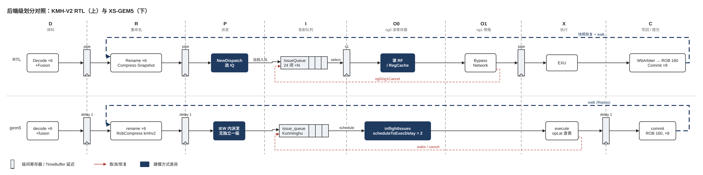

> 本文是 xiangshan-correlation 工作区的学习文档，随仓库保存；图在 `figs/`，来源见 [`figs/README.md`](figs/README.md)。文中的 `文件:行号` 都是相对本仓库的链接，在 VS Code 打开工程后点击可直接跳到对应代码行，GitHub 上同样可点。


# 01 香山流水线微架构总览：RTL 与 gem5 对照

> 学习计划第一步的起点，见 [xiangshan-correlation 学习计划 - 六大思想视角](README.md)。本篇是 2026-10-20 只读勘察本仓库源码得到的"地图"，不是精读结论：标 ✅ 的是直接从代码或配置读出的事实，标 ❓ 的是待核实。目的是让后面每次精读都有坐标。
>
> 读法约定：RTL 和 gem5 描述的是同一条流水线，但写法不同。
>
> - **RTL 写的是实现**：每一拍都靠一个真实的寄存器来实现。读 RTL 要弄清"哪根信号在第几拍有效，是哪个寄存器把它从上一拍传过来的"。
> - **gem5 写的是行为和延迟**：只说每一级做什么、相邻两级之间隔几拍，不建模寄存器。两级之间用 `TimeBuffer` 连接：上游写 `getWire(0)`（[`decode.cc:207`](../../GEM5-XS/src/cpu/o3/decode.cc#L207)），下游读 `getWire(-delay)`（[`decode.cc:216`](../../GEM5-XS/src/cpu/o3/decode.cc#L216) 的 `fetchQueue->getWire(-fetchToDecodeDelay)`），每拍结束时统一 `advance()`（[`cpu.cc:586`](../../GEM5-XS/src/cpu/o3/cpu.cc#L586)）✅。所以 `delay = N` 就相当于 RTL 里两级之间隔着 N 个寄存器。
>
> 对照着读时分两步：
>
> 1. **先在 RTL 里数寄存器。** RTL 里的"一级"有两种来源，和拍数的关系不一样：
>    - **寄存器边界**：模块内部的流水寄存器，例如 IFU 的 f0→f3、BPU 的 s0→s3。每过一个这样的边界就要花一拍。
>    - **模块边界**：两个 Scala 模块之间的接口。端口本身只是连线，要不要花一拍，取决于接口处有没有寄存器。例如 Rename 读 RAT 的请求在 Decode 级就已经发出，跨了模块却不多花一拍。
>
>    所以，模块边界不一定是拍数的边界，一个模块内部也可能有好几拍。
> 2. **再到 gem5 里找对应的延迟参数。** RTL 模块内部的那几拍，gem5 一般不单独分级，而是合并成一个参数来表示，例如 BPU 各级对应每个预测器的 `numDelay`。IFU 的 f0→f3 加上 IBuffer 这一段，在 gem5 里只有 `fetchToDecodeDelay = 2` 加一个 fetchQueue，两边总拍数是否相等还没核实 ❓。RTL 两个模块之间的边界，在 gem5 里对应一个 stage 加一个 TimeBuffer 位置，例如 `decodeToRenameDelay = 1`。
>
> 比较时，看的是一段路径的总拍数，不是级名能不能一一对上。总拍数对不上的地方就是 correlation 要重点检查的地方。例如 RTL 有独立的 [`NewDispatch`](../../XiangShan/src/main/scala/xiangshan/backend/dispatch/NewDispatch.scala#L49) 模块，而 gem5 的 [`enableDispatchStage`](../../GEM5-XS/src/cpu/o3/BaseO3CPU.py#L145) 默认为 False，[`kmhv2.py`](../../GEM5-XS/configs/example/kmhv2.py) 也没有打开它（见下文）。
>
> 课本（Computer Architecture A Quantitative Approach Ch3）没有的东西用 🆕 标出。

---

## 0. 一张图：从预测到提交

先看官方的昆明湖整体架构图，本文的每一节都能在图里找到位置（前端在左上，Rename & Dispatch 在中间，整数 / 浮点 / 向量 / 访存四个 block 在下方）：


下面两张把流水线分成前端和后端，上排 RTL、下排 gem5，每一级标出模块名和 gem5 对应的 delay 参数。深色块是两边建模方式不同的地方。

**前端**（预测、取指、ICache 与 ITLB，到 IBuffer 为止）：前端的范围以 RTL 的 [`Frontend.scala`](../../XiangShan/src/main/scala/xiangshan/frontend/Frontend.scala#L106) 为准，里面有 BPU、FTQ、IFU、IBuffer，以及 [ITLB](../../XiangShan/src/main/scala/xiangshan/frontend/Frontend.scala#L172)、ICache（含 IPrefetch）、PMP 和 InstrUncache；它的出口是 [`io.backend.cfVec <> ibuffer.io.out`](../../XiangShan/src/main/scala/xiangshan/frontend/Frontend.scala#L439)。Decode 在后端的 [`CtrlBlock`](../../XiangShan/src/main/scala/xiangshan/backend/CtrlBlock.scala#L92) 里，图上画出来只是标明前端把指令交给谁，所以两张图都有译码这一列。


从前端图读出的五点：

- **ICache 与 ITLB 的容量两边一致** ✅。RTL ICache 是 [256 组 × 4 路 × 64 B](../../XiangShan/src/main/scala/xiangshan/frontend/icache/ICache.scala#L53) = 64 KB，ITLB [48 项](../../XiangShan/src/main/scala/xiangshan/Parameters.scala#L270)；gem5 L1I [64 kB、4 路](../../GEM5-XS/configs/common/Options.py#L157)，TLB [48 项](../../GEM5-XS/src/arch/riscv/RiscvTLB.py#L70)，检查点模式下走时序 MMU，不是功能 TLB（[`xiangshan.py:256`](../../GEM5-XS/configs/common/xiangshan.py#L256)）。差别在访问方式：RTL 一次取两行、有 FTQ 驱动的预取，gem5 是 classic cache，FDIP 是否建模待核实（清单第 5 条）。
- **预测级的拍数在常见情形下相等，但建模方式不同** ✅。RTL 的 BPU 是 s0→s3 真流水：uFTB 的结果在 s1 就写进 FTQ，后级推翻时再回头改 FTQ、冲掉 IFU。gem5 在同一个 tick 里把三级都算完，只把最终结果交给 FTQ，差的拍数用 `numOverrideBubbles` 停几拍来补。有两种边角情形空泡数不等，其中一种让 gem5 前端更快，见 [01-2](01-2-bpu-override.md)。
- **队列的有效深度两边都是 64** ✅。RTL FTQ 对应 gem5 FSQ，gem5 FTQ 的 128 在 kmhv2 下用不满，见 [01-1](01-1-ftq-decoupled-frontend.md)。
- **取指到译码的总拍数还没对上，是前端最大的嫌疑** ❓。RTL 是 IFU f0→f3 四级寄存器加 IBuffer，IBuffer 为空时可以直通，拍数随状态变化。gem5 是固定的 `fetchToDecodeDelay = 2` 加 fetchQueue，见 [01-3](01-3-ifu.md)。
- **前端内部的反馈线不同**。RTL 有两条：BPU 的 s2/s3 推翻前级时冲掉 IFU 已经发出的取指（`flushFromBpu`）；IFU 在 f3 预译码时发现预测错误，写回 FTQ（`wb_redirect`）。gem5 没有第一条，因为它的 FTQ 收不到错误的预测项，IFU 不会白取。第二种纠错在 gem5 里由 decode 发 squash 回 BPU。所以 RTL 多付一次 IFU 作废的代价；预译码纠错从 f3 发出和从 decode 发出，到重新取指相差几拍，还没核实 ❓。

**后端**（译码到提交）：



从后端图读出的两点：

- **IQ 选中到进 EXU，两边都是 2 拍** ✅。RTL 先经过 DataPath 的 [`s1_toExuData`](../../XiangShan/src/main/scala/xiangshan/backend/datapath/DataPath.scala#L493) 寄存器，这一拍是 og0，读 RF 或 RegCache；再经过 BypassNetwork 之后的 [`NewPipelineConnect`](../../XiangShan/src/main/scala/xiangshan/backend/Backend.scala#L554)，这一拍是 og1。gem5 只用一个 [`scheduleToExecDelay = 2`](../../GEM5-XS/src/cpu/o3/FuncScheduler.py#L86) 表示这两拍：`KunminghuScheduler` 的整数、访存、浮点 IQ 都取这个默认值，只有 [`vecIQ0`](../../GEM5-XS/configs/common/FUScheduler.py#L165) 是 3。
- **译码到派发，两边也都是 2 拍** ✅。RTL 经过两个流水寄存器，[decode→rename](../../XiangShan/src/main/scala/xiangshan/backend/CtrlBlock.scala#L578) 和 [rename→dispatch](../../XiangShan/src/main/scala/xiangshan/backend/CtrlBlock.scala#L704)，然后 NewDispatch 在[当拍写进 IQ](../../XiangShan/src/main/scala/xiangshan/backend/CtrlBlock.scala#L752)。gem5 是 `decodeToRenameDelay = 1` 加 `renameToIEWDelay = 1`，派发在 IEW 里完成，没有独立的一级。指令进 IQ 后最早在哪一拍能被选中，两边是否一致还没核实 ❓。

两张图放在一起看：后端已核对的各段两边都能逐拍对齐，差异集中在前端。这和 78 号点 RTL 前端多出约 108 万 slot 的方向一致。

```
RTL (KMH-V2)                                       gem5 (XS-GEM5 KMH-V2, DecoupledBPUWithFTB)
──────────────────────────────────────────         ─────────────────────────────────────────
BPU  s0 → s1 → s2 → s3   (3 级预测流水, numOfStage=3) numStages = 3, 每个预测器带 numDelay
        │ uFTB  │ TAGE-SC+FTB │ ITTAGE+RAS               uRAS/uFTB 0, TAGE/FTB/RAS 1, ITTAGE 2
        ▼                                                ▼
FTQ  (FtqSize = 64, bpuPtr/ifuPtr/pfPtr/commPtr)   fetch_stream_queue (fsq_size = 64，对应 RTL FTQ)
                                                   └→ fetch_target_queue (ftq_size = 128，不起作用)
        ▼                                                ▼
IFU  f0 → f1 → f2 → f3   (f3_fire = toIbuffer.fire)  fetch stage  ─ fetchToDecodeDelay = 2
        │ 发 ICache │ 算 PC │ 等 ICache 回数据+异常合并 │ 预译码+RVC 展开+MMIO 状态机
        ▼                                                ▼
IBuffer (48 项, 6 bank, 出口宽 DecodeWidth=6)       fetchQueue (48 uop) + fetchBuffer (66 B)
        ▼                                                ▼
Decode (DecodeWidth 6, 含 FusionDecoder)            decode  ─ decodeToRenameDelay = 1
        ▼                                                ▼
Rename (RenameWidth 6, CompressUnit, Snapshot,      rename  ─ renameToIEWDelay = 1
        move 消除, 读 RAT 在 Decode 级就发出)                  RobCompressPolicy = 'kmhv2'
        ▼                                                ▼
NewDispatch → 各 IssueQueue (24 项, 2 enq)          IEW: issue_queue (KunminghuScheduler:
        │  int 4 个 IQ / fp 3 个 / vf 3 个 /                 intIQ0..3 各 2×12, load0..2 各 16,
        │  mem: STA0/1, LDU0/1/2, STD0/1, VLSU0/1          store0/1, std0/1 各 16, fpIQ0..2 18)
        ▼                                                ▼
IQ select → og0 (读 RF / RegCache) → og1 (旁路)     issue → 读寄存器 → execute (opLat 查表)
        ▼                                                ▼
EXU → WbArbiter → ROB (160 项, CommitWidth 8)       execute → writeback → commit (ROB 160, 8 宽)
                                                     iewToCommitDelay = 1, commitToFetchDelay = 3
```

两边核参数已核实一致（decode 6 / rename 6 / commit 8 / ROB 160 / LQ 72 / SQ 56 / 物理整数寄存器 224 / 物理浮点寄存器 192）✅：RTL 见 [`Parameters.scala:149`](../../XiangShan/src/main/scala/xiangshan/Parameters.scala#L149)（DecodeWidth 起）与 [`Parameters.scala:183`](../../XiangShan/src/main/scala/xiangshan/Parameters.scala#L183)（intPreg 起），gem5 见 [`BaseO3CPU.py:132`](../../GEM5-XS/src/cpu/o3/BaseO3CPU.py#L132)（decodeWidth 起）与 [`BaseO3CPU.py:208`](../../GEM5-XS/src/cpu/o3/BaseO3CPU.py#L208)（numPhysIntRegs 起）。向量侧**不一致** ✅：RTL [`vfPreg`](../../XiangShan/src/main/scala/xiangshan/Parameters.scala#L193) 128、[`v0Preg`](../../XiangShan/src/main/scala/xiangshan/Parameters.scala#L198) 22，gem5 [`numPhysVecRegs`](../../GEM5-XS/src/cpu/o3/BaseO3CPU.py#L212) 192、[`numPhysVecPredRegs`](../../GEM5-XS/src/cpu/o3/BaseO3CPU.py#L214) 32。CoreMark 不碰向量，但 SPEC 自动向量化的负载会碰。另外 gem5 [`enableDispatchStage`](../../GEM5-XS/src/cpu/o3/BaseO3CPU.py#L145) 默认 False、[`kmhv2.py`](../../GEM5-XS/configs/example/kmhv2.py) 没有打开 ✅，而 RTL 的 [`NewDispatch`](../../XiangShan/src/main/scala/xiangshan/backend/dispatch/NewDispatch.scala#L49) 是一个独立模块；这是一处级数差异。gem5 的 [`LdPipeStages = 4`](../../GEM5-XS/src/cpu/o3/BaseO3CPU.py#L171)、[`StPipeStages = 5`](../../GEM5-XS/src/cpu/o3/BaseO3CPU.py#L172) 对应香山 LSU 的四级 load、五级 store 流水，gem5 load 流水线建模 - TimeBuffer 与时序保真 已经讲过。

---

## 1. 细节分篇

每一级的细节单独成文，本篇只留地图。前三篇是前端（学习计划第一步的重点），第四篇是后端。

| 篇 | 内容 | 主要结论 |
| --- | --- | --- |
| [01-1 解耦前端：FTQ 与 FTB](01-1-ftq-decoupled-frontend.md) | FTQ 的四个指针、FDIP 指令预取、gem5 的 FSQ 与 FTQ；FTB 为什么按 PC 索引、表项结构与目标拼接、预测块怎么划分 | RTL FTQ 对应 gem5 FSQ，两边都是 64 ✅；FTB 目标只存低位，高位借块起始 PC ✅ |
| [01-2 三级预测流水与 override](01-2-bpu-override.md) | FTB 在 s0–s2 的三拍、预测器组合顺序、两边 override 的建模、预测器表项对照 | 常见情形空泡数相等，两种边角情形不等 ✅ |
| [01-3 IFU 的四拍](01-3-ifu.md) | f0–f3 各拍做什么、gem5 的 `fetchToDecodeDelay`、top-down 按拍打标 | ICache 命中路径总拍数待核实 ❓ |
| [01-4 后端](01-4-backend.md) | 宏融合、ROB 压缩、重命名快照、move 消除、RegCache、og0/og1 | 走读级，待精读 |

---

## 2. 待核实清单（按对 78 号点前端差距的嫌疑排序，2026-10-24 重排）

1. ~~s2/s3 override 的空泡数两边是否等价~~ 已读完，见 [01-2](01-2-bpu-override.md) 的"精读结论"：常见情形相等，两种边角情形不等，且 RTL 多一份 IFU 作废。下一步用 perf 计数器验证第二种。
2. ICache 命中路径从发请求到进 IBuffer 的总拍数。注意 IBuffer 为空时的 bypass 会让这段拍数随状态变化，gem5 的 `fetchToDecodeDelay = 2` 是固定值。
3. 预译码纠错的拍数：RTL 在 IFU f3 发现并写回 FTQ（`wb_redirect`），gem5 由 decode 发 squash；两边从发现错误到重新取指各隔几拍。
4. TAGE 4096 对 2048 是不是 bank 数的差。
5. gem5 是否建模了 FTQ 驱动的指令预取（FDIP），见 [01-1](01-1-ftq-decoupled-frontend.md)。若未建模，ICache 缺失多的负载上 gem5 前端停顿偏多；CoreMark 代码小，影响应不大。
6. `ITLBMissBubble` 按拍打标的确切条件（第二步）。
7. 指令进 IQ 后最早在哪一拍能被选中，见 §0 后端图：RTL 是 NewDispatch 当拍写进 IQ 表项，gem5 是派发在 IEW 里完成后插入 issue_queue。两边差一拍就会拉长所有相关指令的唤醒链，是后端 slot gem5 多出 41 万的候选之一。
8. gem5 宏融合规则是否与 RTL 同一套；regCache 容量；重命名快照对应 `robWalkPolicy`。
9. 向量物理寄存器数不一致（128/22 对 192/32），SPEC 向量化负载前要对齐。

已排除或仅作备注：

- ~~gem5 FTQ 深度 128 对 RTL 64~~ 已排除（2026-10-24）：RTL FTQ 对应的是 gem5 FSQ，两边都是 64，gem5 FTQ 的 128 碰不到，见 [01-1](01-1-ftq-decoupled-frontend.md)。
- gem5 配置脚本疑似 bug：[`xiangshan.py:353`](../../GEM5-XS/configs/common/xiangshan.py#L353) 判断 BTB 的 `if` 被注释掉，loop predictor、loop buffer、jump-ahead 无条件被关闭（第 336 行先把 loop predictor 置为打开）。对 kmhv2 结果是三者都关，不影响当前对照；以后要打开它们时注意。

每核实一条，把本篇对应的 ❓ 改成 ✅ 并写一行结论；结论里带数字的部分放仓库 `Docs/`，本篇只留指针。
